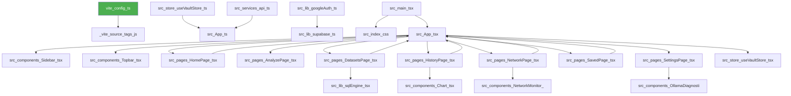

# 📖 RunThis Wiki — vaultiq

> **Auto-generated** by [RunThis](https://github.com/SatyamSinghRajput04/RunThis) on May 22, 2026
> Using: static analysis + AI narration (zero hallucination architecture)

## Quick Stats

| Metric | Value |
|--------|-------|
| Total Files | 30 |
| External Packages | 17 |
| Security Score | 🟡 75/100 |
| Critical Issues | ✅ 0 |
| Complexity Hot-spots | ⚠️ 10 |
| Avg Function Length | 22 lines |
| TODOs / FIXMEs | 0 |
| Stack | Node.js, npm, ESLint, Supabase, Tailwind CSS, Framer Motion, React, Recharts |

> 🟡 **Security Score: 75/100** — Why?
>
>   🟡 Missing CSP Headers
>   ⚪ Unsafe LocalStorage ×3
>   ⚪ Weak Randomness ×17

> ⚠️ **10 complex function(s)** flagged — see Bug-Prone Areas below

---

## 🧠 Project Overview

vaultiq is a comprehensive web application built with Node.js, npm, ESLint, Supabase, Tailwind CSS, Framer Motion, React, and Recharts. The main purpose of this project is to provide an efficient way for users to manage their digital vaults by providing features like saving, analyzing, and visualizing data.

---

## 🏗️ Architecture Map



**Entry Points** (start here): `vite.config.ts`

**Core Files** (imported most): `src/App.tsx, api/_supabase.js, src/lib/sqlEngine.tsx`

**External Packages used:**
- `@eslint/js`
- `@supabase/supabase-js`
- `@tailwindcss/vite`
- `@vitejs/plugin-react`
- `alasql`
- `eslint`
- `eslint-plugin-react-hooks`
- `eslint-plugin-react-refresh`
- `framer-motion`
- `globals`
- `papaparse`
- `react`
- `react-dom`
- `recharts`
- `typescript-eslint`
- `vite`
- `zustand`

---

## 🚩 Where to Start (Onboarding Roadmap)

To start understanding the codebase, one should begin with `vite.config.ts` as it sets up the development environment for Vite, a modern front-end build tool that significantly speeds up development. The core files are: 
1. `src/App.tsx` is the main component of the application and handles routing.
2. `src/pages/*Page.tsx` contain different pages of the application like Home, Saved, Network etc.
3. A key insight to understand the system quickly is that it follows a client-server architecture where data moves from the server to the client for visualization and analysis.

### Suggested Reading Order

1. **`src/services/api.ts`**
   Service layer — encapsulates business logic and external API calls.

2. **`src/lib/supabase.ts`**
   Handles all Supabase authentication and database communication. Critical for user login and data persistence.

3. **`src/lib/sqlEngine.ts`**
   Source file — see the Architecture Map above for its import relationships.

4. **`src/lib/googleAuth.ts`**
   Manages Google OAuth sign-in flow. Connects Google identity to your app's auth system.

5. **`api/_supabase.js`**
   Handles all Supabase authentication and database communication. Critical for user login and data persistence.

6. **`api/_wake.js`**
   Keep-alive / wake endpoint — pings the server to prevent cold starts (common on Vercel).

7. **`api/analyze.js`**
   Core analysis logic — processes data and returns insights or computed results.

8. **`api/datasets.js`**
   Dataset management endpoint — handles reading, filtering, and returning dataset records.

9. **`api/network-log.js`**
   Network monitoring or logging — tracks requests, latency, or connectivity events.

10. **`api/queries.js`**
   Query handler — executes and returns database queries, likely shared across routes.

---

## 🔄 How Data Moves

Data flow in vaultiq can be described as follows: 
1. Data enters through API routes like `src/services/api.ts` which handle requests from users.
2. The data is processed or transformed by various functions in the `src/lib/*.ts` files, such as `generateLocalQuery` function in `src/lib/sqlEngine.ts` for generating SQL queries.
3. Data is stored and sent to the client-side for visualization and analysis like storing user settings in `useVaultStore.ts` or sending data to be displayed on charts using Recharts library in `src/components/VaultChart.tsx`.

---

## 🛣️ API Routes

| Route | Notes |
|-------|-------|
| `/api/_supabase` | Active API endpoint |
| `/api/_wake` | Active API endpoint |
| `/api/analyze` | Active API endpoint |
| `/api/datasets` | Active API endpoint |
| `/api/network-log` | Active API endpoint |
| `/api/queries` | Active API endpoint |
| `/api/saved` | Active API endpoint |
| `/api/workspaces` | Active API endpoint |

---

## 📦 Dependency Intelligence

| Package | Purpose |
|---------|---------|
| `@eslint/js` | ESLint configuration or plugin |
| `@supabase/supabase-js` | Supabase client library for authentication and database |
| `@tailwindcss/vite` | Vite integration plugin for Tailwind CSS v4 |
| `@vitejs/plugin-react` | Vite bundler plugin/utility |
| `alasql` | JavaScript SQL database for browser and Node.js |
| `eslint` | Pluggable JavaScript/TypeScript linter |
| `eslint-plugin-react-hooks` | ESLint configuration or plugin |
| `eslint-plugin-react-refresh` | ESLint configuration or plugin |
| `framer-motion` | Production-ready motion/animation library for React |
| `globals` | Global identifiers for different JS environments |
| `papaparse` | Fast and powerful CSV parser for JavaScript |
| `react` | Frontend library for building user interfaces |
| `react-dom` | Entry point for DOM rendering in React |
| `recharts` | Redefined chart library built with React and D3 |
| `typescript-eslint` | External dependency |
| `vite` | Next-generation frontend tooling (bundler/dev server) |
| `zustand` | Small, fast, and scalable state management solution |

> Tip: Run `runthis scan` for deeper dependency analysis.

---

## ⚠️ Bug-Prone Areas

These functions have high complexity scores. Prioritize testing here.

### `src/pages/DatasetsPage.tsx` — `DatasetsPage()` (line 57)
- **Complexity score:** 7
- **Lines:** 100 | **Max nesting:** 5
- **Why it's risky:** Long function (100 lines), Deep nesting (5 levels)

### `src/pages/AnalyzePage.tsx` — `run()` (line 137)
- **Complexity score:** 7
- **Lines:** 100 | **Max nesting:** 5
- **Why it's risky:** Long function (100 lines), Deep nesting (5 levels)

### `src/lib/sqlEngine.ts` — `generateLocalQuery()` (line 216)
- **Complexity score:** 5
- **Lines:** 100 | **Max nesting:** 4
- **Why it's risky:** Long function (100 lines)

### `src/lib/sqlEngine.ts` — `switch()` (line 245)
- **Complexity score:** 5
- **Lines:** 100 | **Max nesting:** 3
- **Why it's risky:** Long function (100 lines)

### `src/pages/SavedPage.tsx` — `SavedPage()` (line 7)
- **Complexity score:** 5
- **Lines:** 75 | **Max nesting:** 3
- **Why it's risky:** Long function (75 lines)

> Total TODOs/FIXMEs found: **0**
> Missing error handling patterns: **17**

---

## 🔒 Security Report

🟡 **Security Score: 75/100** — Needs Attention

**Why this score?**

- 🟡 **Missing CSP Headers** — e.g. `Project Configuration:0`
- ⚪ **Unsafe LocalStorage** (3 occurrences) — e.g. `src/pages/DatasetsPage.tsx:120`
- ⚪ **Weak Randomness** (17 occurrences) — e.g. `src/pages/AnalyzePage.tsx:42`

**Totals:** Critical: 0 | High: 0 | Total: 21


**Lower severity (21 issues):** Unsafe LocalStorage, Weak Randomness, Missing CSP Headers

> Run `runthis scan` for full security details with line-by-line breakdown.

---

## ⚙️ Setup Guide

### Required Environment Variables

- `VITE_GOOGLE_AUTH_PROXY`
- `VITE_GOOGLE_CLIENT_ID`
- `VITE_SUPABASE_ANON_KEY`
- `VITE_SUPABASE_URL`
- `PORT`

### Quick Start

```bash
# Automated setup with RunThis
runthis setup

# Then run
runthis run
```

---

## 💬 Chat With This Repo

This wiki was generated by **RunThis** — the zero-friction project bootstrapper.

- 🔁 Regenerate: `runthis explain`
- 🔧 Setup project: `runthis setup`
- ▶️  Run project: `runthis run`
- 🔍 Audit: `runthis scan`

> Static analysis by RunThis | AI narration powered by Ollama (private) / OpenAI / Gemini / Groq