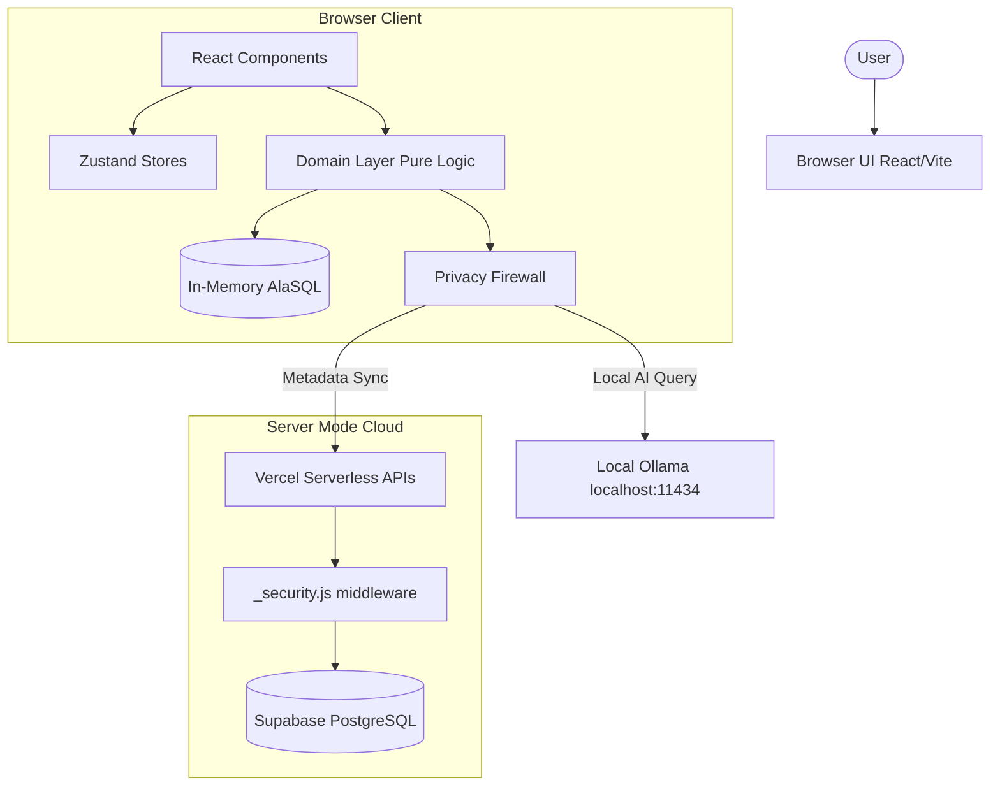
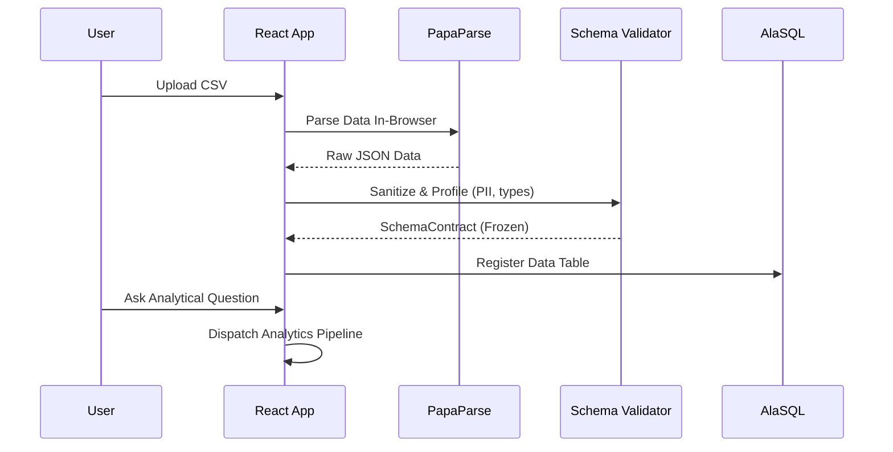
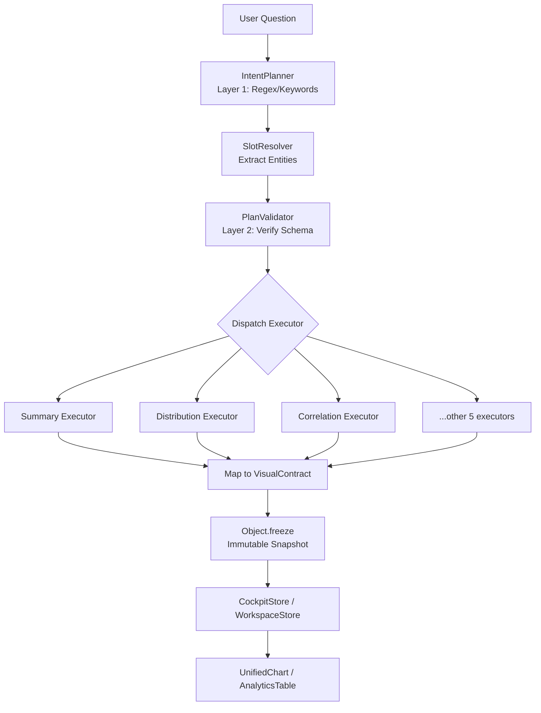
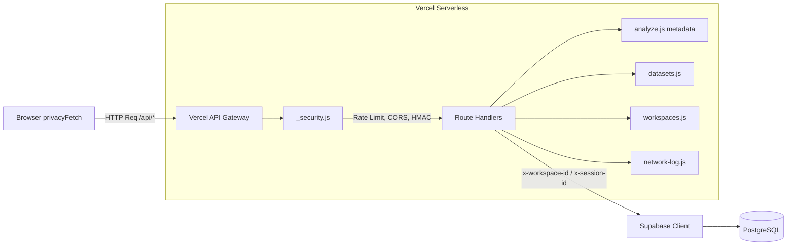

# Privana Architecture

## Overall Architecture

Privana uses a client-side-first architecture with an optional serverless backend. The core principle is that **ALL data processing happens in the browser** — the server only stores metadata.



## Folder Structure

```text
Privana/
├── api/                          # Vercel Serverless API functions (Server Mode)
│   ├── _security.js              # CORS, rate limiting, body size, HMAC hashing
│   ├── _supabase.js              # Supabase client singleton
│   ├── _wake.js                  # Keep-alive endpoint
│   ├── analyze.js                # Metadata-only query persistence
│   ├── datasets.js               # Dataset metadata CRUD
│   ├── queries.js                # Query history CRUD
│   ├── saved.js                  # Bookmarks CRUD
│   ├── workspaces.js             # Workspace CRUD with tenant isolation
│   └── network-log.js            # Network audit log sync
│
├── src/
│   ├── components/               # Shared UI components
│   │   ├── analytics/            # New modular analytics UI components
│   │   │   ├── CockpitFilters.tsx
│   │   │   ├── DatasetProfilePanel.tsx
│   │   │   ├── QueryPanel.tsx
│   │   │   ├── QueryResultCanvas.tsx
│   │   │   └── WorkspaceTabs.tsx
│   │   ├── AnalyticsTable.tsx     # Smart data grid with spark-bars
│   │   ├── ErrorBoundary.tsx      # React error boundary
│   │   ├── NetworkMonitor.tsx     # Real-time audit log UI
│   │   ├── OllamaDiagnostics.tsx  # Ollama health checker
│   │   ├── Sidebar.tsx            # Navigation rail
│   │   ├── Topbar.tsx             # Header bar
│   │   └── UnifiedChart.tsx       # Universal Recharts wrapper
│   │
│   ├── domain/                    # Domain layer (pure business logic)
│   │   ├── analytics/             # Main analytics orchestrator
│   │   │   ├── __tests__/         # 16 test files
│   │   │   ├── executors/         # 8 intent executors (summary, distribution, correlation, etc.)
│   │   │   ├── features/          # React UI for result views
│   │   │   │   ├── plan-preview/
│   │   │   │   ├── query-ready/
│   │   │   │   └── result-view/   # BlockedView, ClarifyView, ComputedView, etc.
│   │   │   ├── intentPlanner.ts   # Layer 1 regex/keyword intent compiler
│   │   │   ├── planValidator.ts   # Layer 2 schema validation
│   │   │   ├── runAnalyticsQuestion.ts  # S9 ORCHESTRATOR - main pipeline
│   │   │   ├── schemaIntelligence.ts    # Column resolution + suggestions
│   │   │   ├── semanticResolver.ts      # N-gram tokenizer
│   │   │   ├── slotResolver.ts          # Entity extraction
│   │   │   ├── workspaceQueryEngine.ts  # Multi-sheet canvas compiler
│   │   │   └── types.ts                 # Contracts & discriminated unions
│   │   ├── resolver/              # Fuzzy column matching (Jaro-Winkler)
│   │   ├── safeCompute/           # Statistical math engine
│   │   │   ├── index.ts           # runSafeCompute orchestrator
│   │   │   ├── relationshipRanker.ts  # Pearson, Spearman, ANOVA, Chi-Square
│   │   │   ├── corrections.ts    # Benjamini-Hochberg FDR
│   │   │   └── ...
│   │   ├── shadow/                # Shadow testing (legacy vs new pipeline)
│   │   ├── sql/                   # Parameterized SQL generator
│   │   ├── types/                 # Global type definitions
│   │   ├── validator/             # Dataset profiling & PII detection
│   │   └── verifier/              # Post-execution result verification
│   │
│   ├── infrastructure/            # Infrastructure layer
│   │   └── firewall/
│   │       ├── firewall.ts        # PII scanner, Luhn checker, audit logger
│   │       └── privacyFetch.ts    # Fail-closed egress interceptor
│   │
│   ├── lib/                       # Shared utilities
│   │   ├── sqlEngine.ts           # AlaSQL wrapper, CSV/JSON loader, LRU cache
│   │   ├── indexedDb.ts           # IndexedDB persistence adapter
│   │   ├── schemaFirewall.ts      # Column name obfuscation for LLMs
│   │   ├── expandToBlueprint.ts   # Result → WorkspaceBlueprint
│   │   ├── datasetSeeder.ts       # Synthetic demo data generator
│   │   └── ...
│   │
│   ├── pages/                     # Route components
│   │   ├── AnalyzePage.tsx        # Core analytics surface (210KB - needs refactoring!)
│   │   ├── LandingPage.tsx        # Auth gate + mode selection
│   │   ├── DatasetsPage.tsx       # Upload & manage datasets
│   │   ├── HistoryPage.tsx        # Query history
│   │   └── ...
│   │
│   ├── services/                  # API client layer
│   │   └── api.ts                 # privacyFetch-wrapped REST client
│   │
│   ├── store/                     # State management (Zustand)
│   │   ├── useVaultStore.ts       # Global state, auth, datasets, queries
│   │   ├── useCockpitStore.ts     # Real-time analytics cockpit state
│   │   └── useWorkspaceStore.ts   # Multi-sheet workspace state
│   │
│   ├── App.tsx                    # Root shell + routing
│   ├── main.tsx                   # Entry point
│   └── index.css                  # Design system (43KB)
│
├── scratch/                       # Dev scripts, tests, patches
└── Configuration files            # vite.config.ts, vercel.json, etc.
```

## Data Flow

1. User uploads CSV → `PapaParse` parses in-browser → Data sanitized (UTF-8, dates, nulls)
2. Schema profiled (column types, cardinality, PII detection) → `SchemaContract` frozen
3. Data registered in `AlaSQL` in-memory table
4. User asks question → `IntentPlanner` classifies intent → `SlotResolver` extracts entities
5. `PlanValidator` verifies columns exist → Executor dispatched (8 types)
6. Results mapped to `VisualContract` → Committed to `CockpitStore` (`Object.freeze`)
7. `UnifiedChart` / `AnalyticsTable` renders from immutable snapshot



### Analytics Pipeline



## Server Mode & API Flow

- Only **metadata** (hashed questions, timestamps) is sent to Supabase via `privacyFetch`
- **Raw data NEVER leaves the browser**
- The `privacyFetch` interceptor classifies all URLs into: same-origin, loopback, private LAN, company server, or BLOCKED external.

### API Flow

All API endpoints at `/api/*` are Vercel serverless functions:
- `_security.js` provides CORS, rate limiting (60/min), body size (10KB), HMAC hashing
- Each endpoint enforces `x-workspace-id` and `x-session-id` headers
- Tenant isolation via HMAC-derived owner tokens
- `analyze.js` is METADATA-ONLY — it never computes analytics server-side



## Database Design (Supabase PostgreSQL)

Tables: `viq_workspaces`, `viq_datasets`, `viq_queries`, `viq_saved_analyses`, `viq_network_log`
- All tables scoped by `workspace_id`
- Tenant isolation via `HMAC(session_id)` → owner token
- Questions stored as SHA-256 HMAC hashes (never plaintext)

## External Services

- **Supabase**: PostgreSQL + Auth (Server Mode only)
- **Ollama**: Local LLM inference (`localhost:11434`)
- **Google OAuth**: Optional authentication
- **Vercel**: Serverless deployment

## AI Workflow

1. **Schema Firewall** obfuscates columns (e.g., `salary` → `c1`, `name` → `c2`)
2. Obfuscated schema + question sent to local Ollama LLM
3. LLM generates SQL using placeholder names
4. Schema Firewall restores real column names in SQL
5. SQL executed locally via AlaSQL

## Design Decisions

- **Local-first**: All computation happens in the browser → zero data egress.
- **Discriminated Unions**: Used for `AnalyticsResult` (7 states) and `VisualContract` (7 kinds) to ensure type safety.
- **Immutable Snapshots**: `Object.freeze` on committed results prevents accidental state mutation.
- **Fail-closed Firewall**: Unknown URLs are blocked by default via `privacyFetch`.
- **LRU Cache**: Caches up to 50 entries / 64MB for query results to ensure UI responsiveness.
- **Session-salted SHA-256**: Used for audit log hashing to preserve privacy.
