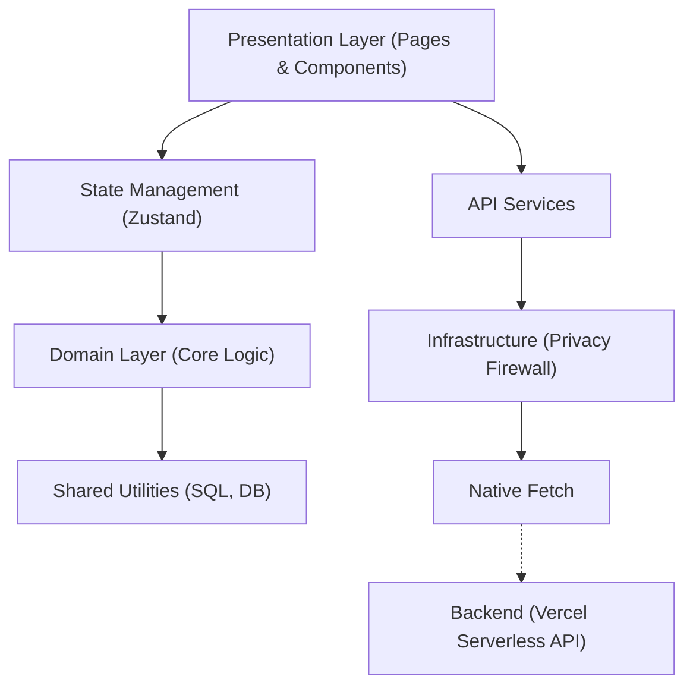
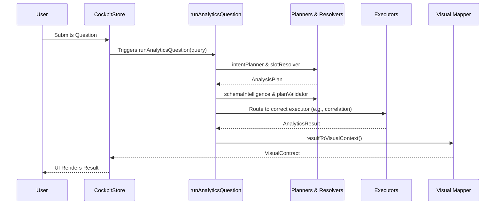

# Privana Codebase Guide

Welcome to the Privana Codebase Guide. This document provides a comprehensive overview of the repository's architecture, major directories, key files, responsibilities, and data flows. 

Whether you are a beginner onboarding onto the project or an experienced developer tracing a complex data flow, this guide serves as the definitive map of the application.

## 🏗️ Architecture & Communication Patterns

Privana strictly separates concerns across Presentation, State, Domain, Infrastructure, and Backend layers. 

### High-Level Architecture

### Core Communication Rules
1. **Unidirectional Data Flow**: Pages → Stores → Domain Layer. 
2. **Pure Domain Logic**: Domain executors are pure functions with absolutely no React dependencies.
3. **Secure Networking**: All network requests pass through `privacyFetch` → `Firewall audit` → Native `fetch`.
4. **Reactive UI**: Store updates trigger React re-renders via Zustand selectors.

---

## 📂 Directory Structure

### 1. Domain Layer (`src/domain/`)
The heart of the application. Contains all business logic, data processing, and validation rules.

#### `src/domain/analytics/` (Main Analytics Orchestrator)
**Purpose:** Central Q&A planning, validation, execution, and narrative compilation.
**Entry point:** [runAnalyticsQuestion.ts](file:///c:/Users/dell/NewProject/.vscode/Project/Privana/src/domain/analytics/runAnalyticsQuestion.ts) (S9 Orchestrator)

| Component | Key Files | Description |
| :--- | :--- | :--- |
| **Contracts** | [types.ts](file:///c:/Users/dell/NewProject/.vscode/Project/Privana/src/domain/analytics/types.ts) | Defines `SUPPORTED_INTENTS` (8 intents), `AnalysisPlan`, `AnalyticsResult` (7-state discriminated union), `VisualContract`, `WorkspaceBlueprint`, and `CardSpec`. |
| **Planners** | [intentPlanner.ts](file:///c:/Users/dell/NewProject/.vscode/Project/Privana/src/domain/analytics/intentPlanner.ts) | Layer 1 regex/keyword intent compiler with confidence scoring (0.50-0.95). |
| **Resolvers** | [slotResolver.ts](file:///c:/Users/dell/NewProject/.vscode/Project/Privana/src/domain/analytics/slotResolver.ts) | Layer 2 entity extraction (metric, groupBy, filters, target, limit). |
| | [semanticResolver.ts](file:///c:/Users/dell/NewProject/.vscode/Project/Privana/src/domain/analytics/semanticResolver.ts) | N-gram tokenizer mapping question terms to columns. |
| **Validation** | [planValidator.ts](file:///c:/Users/dell/NewProject/.vscode/Project/Privana/src/domain/analytics/planValidator.ts) | Schema validation against dataset profile. |
| | [schemaIntelligence.ts](file:///c:/Users/dell/NewProject/.vscode/Project/Privana/src/domain/analytics/schemaIntelligence.ts) | Levenshtein-based column suggestions & role inference. |
| **Execution** | [workspaceQueryEngine.ts](file:///c:/Users/dell/NewProject/.vscode/Project/Privana/src/domain/analytics/workspaceQueryEngine.ts) | Multi-sheet canvas compiler with parallel card execution. |
| | `executors/` | 8 executor strategies (summary, distribution, groupedAverage, correlation, featureImportance, ranking, filter, comparison). |
| **Mapping** | [resultToVisualContext.ts](file:///c:/Users/dell/NewProject/.vscode/Project/Privana/src/domain/analytics/resultToVisualContext.ts) | Maps `AnalyticsResult` to `VisualContract`. |
| **Telemetry** | [evalLogger.ts](file:///c:/Users/dell/NewProject/.vscode/Project/Privana/src/domain/analytics/evalLogger.ts) | IndexedDB evaluation log. |
| **UI** | `features/` | React UI components (`PlanPreview`, `QueryReadyState`, `ResultView`, `BlockedView`, `ClarifyView`, `ComputedView`, `ErrorView`, `RefusedView`, `UnsupportedView`). |
| **Testing** | `__tests__/` | 16 test files covering all executors and resolvers. |

#### `src/domain/safeCompute/` (Statistical Math Engine)
**Purpose:** Standalone mathematical engine for feature importance ranking.
**Entry point:** [index.ts](file:///c:/Users/dell/NewProject/.vscode/Project/Privana/src/domain/safeCompute/index.ts) (`runSafeCompute`)

| Component | Key Files | Description |
| :--- | :--- | :--- |
| **Math** | [relationshipRanker.ts](file:///c:/Users/dell/NewProject/.vscode/Project/Privana/src/domain/safeCompute/relationshipRanker.ts) | Pearson, Spearman, Point-Biserial, ANOVA (Eta²), Cramer's V, Chi-Square + Lanczos log-gamma + Student's t/F-distribution p-values. |
| **Corrections**| [corrections.ts](file:///c:/Users/dell/NewProject/.vscode/Project/Privana/src/domain/safeCompute/corrections.ts) | Benjamini-Hochberg FDR + Bonferroni corrections. |
| **Orchestration**| [statPlanner.ts](file:///c:/Users/dell/NewProject/.vscode/Project/Privana/src/domain/safeCompute/statPlanner.ts) [intentResolver.ts](file:///c:/Users/dell/NewProject/.vscode/Project/Privana/src/domain/safeCompute/intentResolver.ts) | Column profiling, statistical method selection, Q&A intent classification. |
| **Safety** | [preflight.ts](file:///c:/Users/dell/NewProject/.vscode/Project/Privana/src/domain/safeCompute/preflight.ts) | Dataset safety validation (metadata detection). |
| **Types** | [types.ts](file:///c:/Users/dell/NewProject/.vscode/Project/Privana/src/domain/safeCompute/types.ts) | Contains `FeatureImportanceRow` and `SafeComputeResult`. |

#### Additional Domain Modules
*   **Fuzzy Matching (`src/domain/resolver/`)**: [resolver.ts](file:///c:/Users/dell/NewProject/.vscode/Project/Privana/src/domain/resolver/resolver.ts) implements a multi-tier resolution chain (Exact → Entity-ID → Alias → Domain Synonym → Jaro-Winkler fuzzy).
*   **Dataset Profiling (`src/domain/validator/`)**: [validator.ts](file:///c:/Users/dell/NewProject/.vscode/Project/Privana/src/domain/validator/validator.ts) handles column type classification (numeric/category/date/text/boolean/identifier) and PII detection (email/phone/SSN).
*   **SQL Generation (`src/domain/sql/`)**: [sqlGenerator.ts](file:///c:/Users/dell/NewProject/.vscode/Project/Privana/src/domain/sql/sqlGenerator.ts) maps `QueryPlan` to parameterized SQL with bracket-escaped identifiers.
*   **Shadow Testing (`src/domain/shadow/`)**: [shadowTester.ts](file:///c:/Users/dell/NewProject/.vscode/Project/Privana/src/domain/shadow/shadowTester.ts) verifies parity by comparing legacy vs. parameterized SQL.
*   **Verification (`src/domain/verifier/`)**: [verifier.ts](file:///c:/Users/dell/NewProject/.vscode/Project/Privana/src/domain/verifier/verifier.ts) handles post-execution invariant checks (NaN/Infinity, n<5 suppression).

---

### 2. Infrastructure Layer (`src/infrastructure/`)
Manages security, privacy, and low-level system interactions.

#### `src/infrastructure/firewall/` (Privacy Infrastructure)
| File | Responsibility |
| :--- | :--- |
| [firewall.ts](file:///c:/Users/dell/NewProject/.vscode/Project/Privana/src/infrastructure/firewall/firewall.ts) | PII scanner (email, phone, credit card with Luhn, SSN, Aadhaar, PAN, API keys, PEM keys), session-salted SHA-256 hashing, IndexedDB audit logging. |
| [privacyFetch.ts](file:///c:/Users/dell/NewProject/.vscode/Project/Privana/src/infrastructure/firewall/privacyFetch.ts) | Fail-closed fetch interceptor with 6 route classifications (same-origin, loopback, private LAN, company server, network-log, BLOCKED). |

---

### 3. Core Libraries (`src/lib/`)
Shared utilities utilized across multiple domains.

| File | Description |
| :--- | :--- |
| [sqlEngine.ts](file:///c:/Users/dell/NewProject/.vscode/Project/Privana/src/lib/sqlEngine.ts) | AlaSQL wrapper, CSV/JSON loader with 100MB/500-col caps, SchemaContract profiling, parameterized filter compiler, 50-entry/64MB LRU cache. |
| [indexedDb.ts](file:///c:/Users/dell/NewProject/.vscode/Project/Privana/src/lib/indexedDb.ts) | IndexedDB adapter (`privana_local_db` v2) for datasets, workspaces, queries, bookmarks, audit logs (1000-entry auto-pruning). |
| [schemaFirewall.ts](file:///c:/Users/dell/NewProject/.vscode/Project/Privana/src/lib/schemaFirewall.ts) | LLM schema obfuscation middleware (column→c0, c1... table→t0). |
| [expandToBlueprint.ts](file:///c:/Users/dell/NewProject/.vscode/Project/Privana/src/lib/expandToBlueprint.ts) | Factory converting `AnalyticsResult` to `WorkspaceBlueprint`. |
| [matchResultToSheet.ts](file:///c:/Users/dell/NewProject/.vscode/Project/Privana/src/lib/matchResultToSheet.ts) | Column-overlap sheet matching heuristic. |
| [datasetSeeder.ts](file:///c:/Users/dell/NewProject/.vscode/Project/Privana/src/lib/datasetSeeder.ts) | Synthetic 1200-row Teen Mental Health demo CSV generator. |
| [flags.ts](file:///c:/Users/dell/NewProject/.vscode/Project/Privana/src/lib/flags.ts) | Feature flag system (e.g., `USE_NEW_ANALYTICS_PIPELINE`, `USE_LLM_PLAN_PROPOSER`). |
| [googleAuth.ts](file:///c:/Users/dell/NewProject/.vscode/Project/Privana/src/lib/googleAuth.ts) | Google OAuth popup + postMessage flow. |
| [supabase.ts](file:///c:/Users/dell/NewProject/.vscode/Project/Privana/src/lib/supabase.ts) | Supabase client singleton. |

---

### 4. State Management (`src/store/`)
Zustand stores defining global state and providing reactive bindings to React.

| File | Description |
| :--- | :--- |
| [useVaultStore.ts](file:///c:/Users/dell/NewProject/.vscode/Project/Privana/src/store/useVaultStore.ts) | Global state for auth, workspaces, datasets, queries, bookmarks, Ollama status, egress stats. Features dual-mode dispatch (solo=IndexedDB vs server=API). |
| [useCockpitStore.ts](file:///c:/Users/dell/NewProject/.vscode/Project/Privana/src/store/useCockpitStore.ts) | Real-time analytics state: `activeQuestion`, `filterContext`, `committedVisual`, `runId` concurrency guard, PII-redacted telemetry. |
| [useWorkspaceStore.ts](file:///c:/Users/dell/NewProject/.vscode/Project/Privana/src/store/useWorkspaceStore.ts) | Multi-sheet workspace state: blueprints, cards, contextual Q&A injection, 5-sheet FIFO snapshot queue. |

---

### 5. Services Layer (`src/services/`)
Client wrappers for HTTP communication.

*   [api.ts](file:///c:/Users/dell/NewProject/.vscode/Project/Privana/src/services/api.ts): REST client wrapping all HTTP calls. Crucially, all requests are routed through `privacyFetch` to enforce firewall constraints.

---

### 6. Presentation Layer (`src/pages/` & `src/components/`)
The React user interface.

#### Pages (`src/pages/`)
> [!WARNING]
> **Technical Debt Alert**
> [AnalyzePage.tsx](file:///c:/Users/dell/NewProject/.vscode/Project/Privana/src/pages/AnalyzePage.tsx) is currently a monolithic ~4000-line file (210KB) containing legacy inline math/stats, custom markdown rendering, and hardcoded schema processing. This file urgently requires refactoring to conform to the strict UI-Domain separation seen in newer parts of the codebase.

*   [LandingPage.tsx](file:///c:/Users/dell/NewProject/.vscode/Project/Privana/src/pages/LandingPage.tsx): Auth + mode selection (Solo/Server).
*   [DatasetsPage.tsx](file:///c:/Users/dell/NewProject/.vscode/Project/Privana/src/pages/DatasetsPage.tsx): CSV/JSON upload with drag-and-drop support.
*   [HistoryPage.tsx](file:///c:/Users/dell/NewProject/.vscode/Project/Privana/src/pages/HistoryPage.tsx): Query history viewer.
*   [SavedPage.tsx](file:///c:/Users/dell/NewProject/.vscode/Project/Privana/src/pages/SavedPage.tsx): Bookmarked analyses.
*   [SettingsPage.tsx](file:///c:/Users/dell/NewProject/.vscode/Project/Privana/src/pages/SettingsPage.tsx): LLM/TEE configuration (mostly placeholder).
*   [NetworkPage.tsx](file:///c:/Users/dell/NewProject/.vscode/Project/Privana/src/pages/NetworkPage.tsx): Privacy audit log viewer.
*   [HomePage.tsx](file:///c:/Users/dell/NewProject/.vscode/Project/Privana/src/pages/HomePage.tsx): Dashboard overview.

#### Shared Components (`src/components/`)
*   [UnifiedChart.tsx](file:///c:/Users/dell/NewProject/.vscode/Project/Privana/src/components/UnifiedChart.tsx): Universal Recharts adapter (bar, line, scatter, pie/donut).
*   [AnalyticsTable.tsx](file:///c:/Users/dell/NewProject/.vscode/Project/Privana/src/components/AnalyticsTable.tsx): Smart data grid with spark-bars.
*   [Sidebar.tsx](file:///c:/Users/dell/NewProject/.vscode/Project/Privana/src/components/Sidebar.tsx): Navigation rail with egress telemetry.
*   [Topbar.tsx](file:///c:/Users/dell/NewProject/.vscode/Project/Privana/src/components/Topbar.tsx): Breadcrumb header.
*   [NetworkMonitor.tsx](file:///c:/Users/dell/NewProject/.vscode/Project/Privana/src/components/NetworkMonitor.tsx): Real-time audit event log.
*   [ErrorBoundary.tsx](file:///c:/Users/dell/NewProject/.vscode/Project/Privana/src/components/ErrorBoundary.tsx): React error catch boundary.
*   [OllamaDiagnostics.tsx](file:///c:/Users/dell/NewProject/.vscode/Project/Privana/src/components/OllamaDiagnostics.tsx): Ollama connection tester.

---

### 7. Backend (`api/`)
Vercel Serverless Functions. All endpoints enforce CORS, rate limiting (60/min), body size limits (10KB), and session/workspace header validation.

| File | Description |
| :--- | :--- |
| `analyze.js` | Persists hashed questions (metadata-only); never computes analytics server-side. |
| `workspaces.js` | CRUD operations with HMAC tenant isolation. |
| `datasets.js` | Standard CRUD with workspace scoping. |
| `queries.js` | Standard CRUD with workspace scoping. |
| `saved.js` | Standard CRUD with workspace scoping. |
| `network-log.js` | Audit log sync with server-side PII/SQL/secret scanning. |
| `_security.js` | Shared security middleware. |
| `_supabase.js` | Supabase singleton. |
| `_wake.js` | Cold start prevention. |

---

## 🔄 Analytics Request Data Flow

When a user asks a question, the execution follows this strictly orchestrated path:

