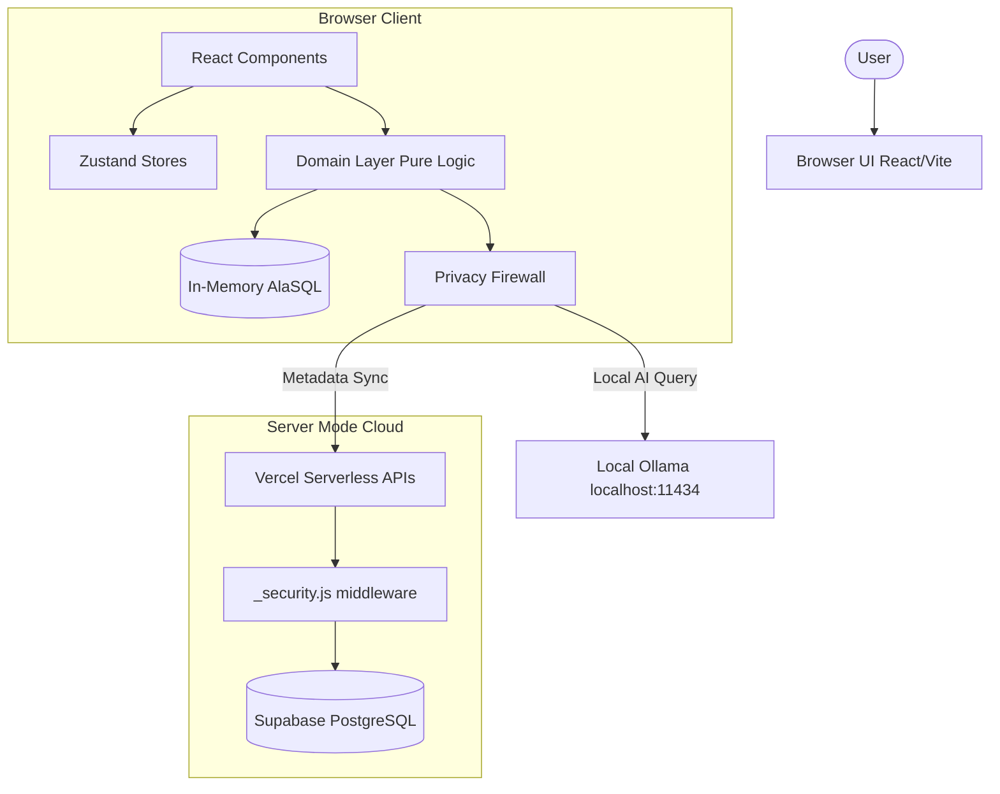
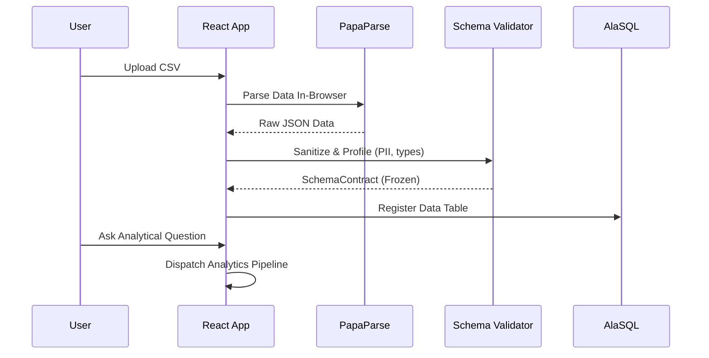
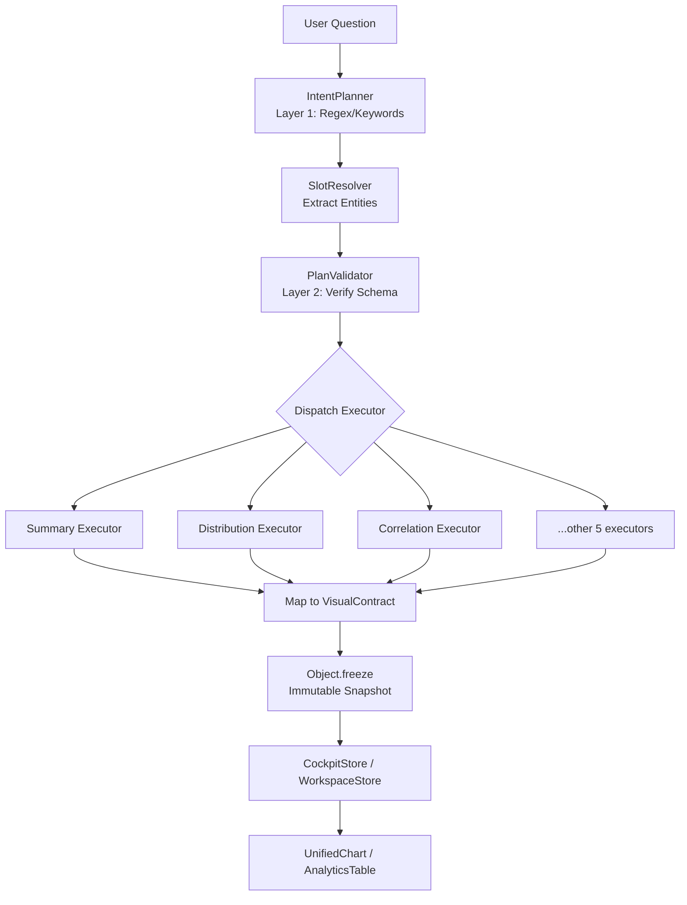
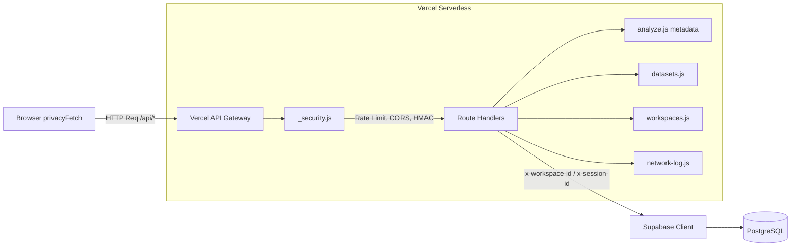
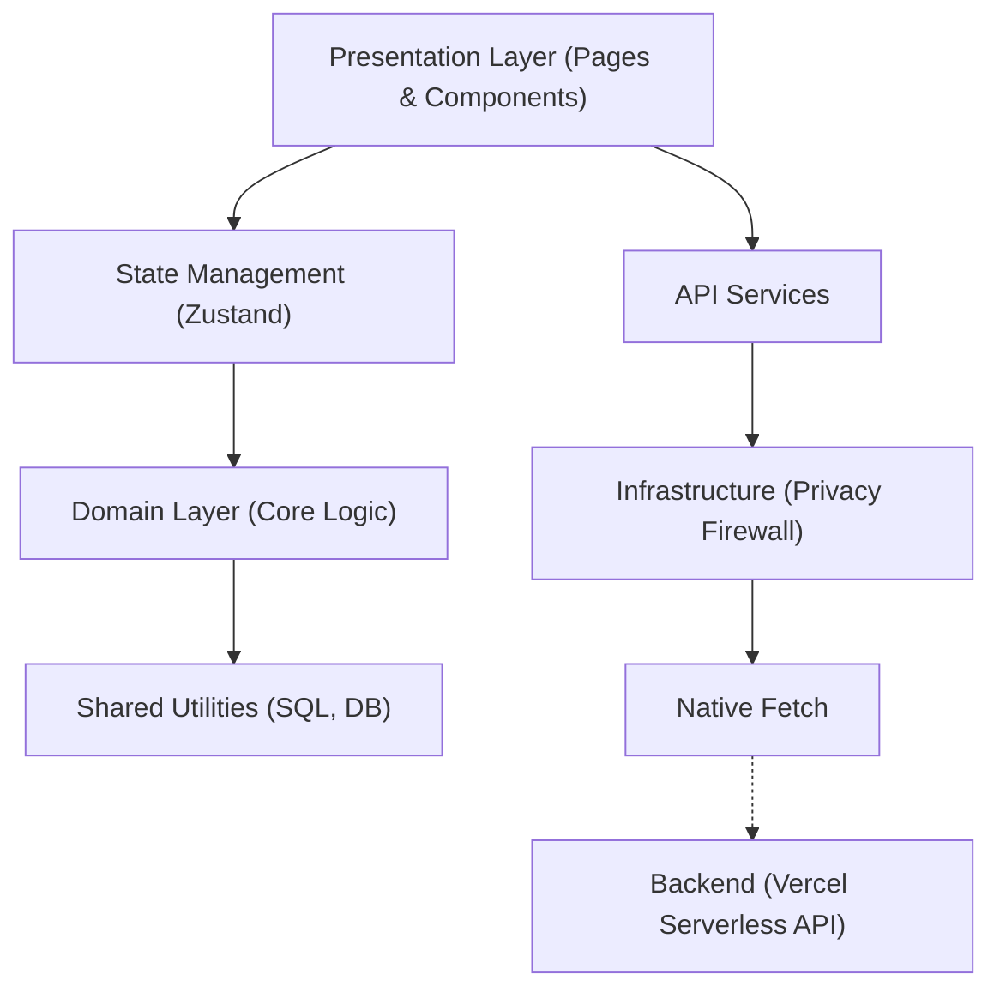
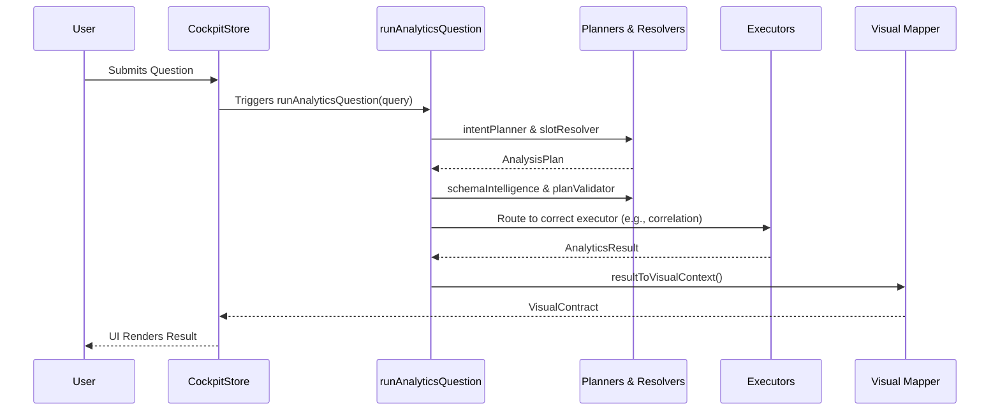

# Privana - Complete System Documentation

Welcome to the unified master documentation for **Privana**, the privacy-first local AI analytics platform. This document consolidates all 10 technical documentation modules into a single, comprehensive reference manual for developers, architects, security auditors, mentors, and investors.

---

## Table of Contents

- [1. Project Overview](#1-project-overview)
- [2. Architecture](#2-architecture)
- [3. Codebase Guide](#3-codebase-guide)
- [4. Setup & Installation](#4-setup--installation)
- [5. API Reference](#5-api-reference)
- [6. Features](#6-features)
- [7. Technical Decisions](#7-technical-decisions)
- [8. Architectural Review & Audit](#8-architectural-review--audit)
- [9. Roadmap & Technical Debt](#9-roadmap--technical-debt)
- [10. Contributing Guide](#10-contributing-guide)

---


---

## 1. Project Overview

# Privana - Project Overview

Privana is a privacy-first local AI analytics platform designed to solve the critical data privacy challenges inherent in modern Business Intelligence (BI) and Artificial Intelligence (AI) tools.

## The Problem

Modern BI and AI analytics tools (such as Tableau, Power BI, and Cloud LLMs) require users to upload sensitive datasets to external servers. This practice creates significant risks:
- **Regulatory Violations**: Potential breaches of GDPR, HIPAA, and other data protection regulations.
- **Intellectual Property (IP) Leakage**: Exposure of proprietary algorithms, formulas, or business metrics.
- **Zero Data Sovereignty**: Loss of control over where and how data is stored and processed.

## The Solution

Privana inverts the traditional trust model. The entire analytical pipeline runs **locally** on the user's machine:
- CSV files are parsed directly in-browser—they never touch a server.
- Plain English questions are converted to SQL locally using an Ollama LLM.
- Statistical analysis is executed entirely on the user's CPU.
- **Zero bytes of raw data ever leave the device.**

## Target Users

- Data Professionals
- Compliance-Conscious Enterprises
- Healthcare Analysts
- Financial Analysts
- HR Teams (handling sensitive employee data)
- Privacy-Conscious Researchers

## Key Features

| Feature | Description |
|---|---|
| **Solo Mode** | Fully offline operation with zero authentication and zero cloud dependency. |
| **Server Mode** | Optional team collaboration where only metadata is synced; raw data remains local. |
| **Natural Language Queries** | Users can ask questions in plain English and receive charts and insights. |
| **Local AI via Ollama** | Connects to locally hosted LLMs (e.g., CodeLlama, Llama 3) for processing. |
| **In-Browser SQL Engine** | Powered by AlaSQL to run SQL queries entirely inside the browser environment. |
| **Statistical Analysis Engine** | Computes Pearson r, Spearman ρ, Point-Biserial, ANOVA, Cramer's V, Chi-Square, Benjamini-Hochberg FDR correction, OLS regression, and p-values locally. |
| **Schema Firewall** | Obfuscates column names before any calls are made to the LLM to protect data structure. |
| **Privacy Firewall** | Implements fail-closed egress control and PII scanning for emails, phones, SSNs, credit cards, and API keys. |
| **Privacy Audit Log** | Network monitor confirming zero outbound data connections for raw data. |
| **Workspace Blueprint System** | Auto-generates multi-sheet analytical dashboards. |
| **Feature Importance Engine** | Ranks feature associations utilizing various statistical methods. |
| **Interactive Clarification** | When query confidence falls between 60-85%, users can select from suggested paths to refine queries. |

## Tech Stack

| Category | Technology |
|---|---|
| **Frontend** | React 19 + TypeScript + Vite 7 |
| **Styling** | TailwindCSS v4 + Custom CSS Design System |
| **State Management** | Zustand 5 (VaultStore, CockpitStore, WorkspaceStore) |
| **Charts & Animations** | Recharts 3 + Framer Motion 12 |
| **In-Browser SQL** | AlaSQL 4 |
| **CSV Parsing** | PapaParse 5 |
| **Local AI** | Ollama (localhost:11434) |
| **Local Storage** | IndexedDB + LocalStorage |
| **Server Mode Backend**| Vercel Serverless Functions + Supabase PostgreSQL |
| **Icons** | Lucide React |

## Current Status

- **Stage**: MVP/Alpha
- **Functionality**: The core analytics pipeline is functional. Solo mode operates fully offline, and Server mode works via Vercel + Supabase.
- **Testing**: The project currently has 16 unit tests covering the analytics domain layer.
- **Technical Debt**: `AnalyzePage.tsx` is a large 210KB monolith that requires refactoring.
- **Ongoing Work**: There is an active migration from a legacy inline analytics pipeline to a new, robust domain-driven architecture.

## High-Level Architecture

Privana operates as a Client-side React Single Page Application (SPA) with a local-first architecture. The Domain layer handles all computation, the Infrastructure layer provides the privacy firewall, and an optional serverless API layer handles metadata synchronization.

```mermaid
graph TD
    subgraph Client Application [User Machine - Local Processing]
        UI[React UI / Workspace]
        
        subgraph Domain Layer
            NLP[Natural Language Engine]
            SQL[AlaSQL Engine]
            Stat[Statistical Analysis Engine]
            Features[Feature Importance Engine]
        end
        
        subgraph Infrastructure Layer
            SchemaFW[Schema Firewall]
            PrivacyFW[Privacy Firewall / PII Scanner]
            Storage[IndexedDB / LocalStorage]
        end
        
        UI -->|Plain English| NLP
        NLP <-->|Obfuscated Schema| SchemaFW
        SchemaFW <-->|Prompt/SQL| LocalLLM[(Ollama - Localhost)]
        
        UI -->|Raw CSV| PrivacyFW
        PrivacyFW -->|Clean Data| SQL
        NLP -->|Generated SQL| SQL
        
        SQL -->|Data Views| Stat
        SQL -->|Data Views| Features
        
        Stat -->|Results| UI
        Features -->|Results| UI
        SQL -->|Raw Output| UI
        
        PrivacyFW <--> Storage
    end

    subgraph Optional Cloud [Metadata Only]
        Vercel[Vercel Serverless Functions]
        Supabase[(Supabase PostgreSQL)]
    end

    UI -.->|Sync Metadata Only| Vercel
    Vercel -.-> Supabase

    classDef local fill:#e6f3ff,stroke:#0066cc,stroke-width:2px
    classDef cloud fill:#f9f9f9,stroke:#999,stroke-width:1px,stroke-dasharray: 5 5
    
    class Client Application,Domain Layer,Infrastructure Layer local
    class Optional Cloud,Vercel,Supabase cloud
```


---

## 2. Architecture

# Privana Architecture

## Overall Architecture

Privana uses a client-side-first architecture with an optional serverless backend. The core principle is that **ALL data processing happens in the browser** — the server only stores metadata.



## Folder Structure

```text
Privana/
├── api/                          # Vercel Serverless API functions (Server Mode)
│   ├── _security.js              # CORS, rate limiting, body size, HMAC hashing
│   ├── _supabase.js              # Supabase client singleton
│   ├── _wake.js                  # Keep-alive endpoint
│   ├── analyze.js                # Metadata-only query persistence
│   ├── datasets.js               # Dataset metadata CRUD
│   ├── queries.js                # Query history CRUD
│   ├── saved.js                  # Bookmarks CRUD
│   ├── workspaces.js             # Workspace CRUD with tenant isolation
│   └── network-log.js            # Network audit log sync
│
├── src/
│   ├── components/               # Shared UI components
│   │   ├── analytics/            # New modular analytics UI components
│   │   │   ├── CockpitFilters.tsx
│   │   │   ├── DatasetProfilePanel.tsx
│   │   │   ├── QueryPanel.tsx
│   │   │   ├── QueryResultCanvas.tsx
│   │   │   └── WorkspaceTabs.tsx
│   │   ├── AnalyticsTable.tsx     # Smart data grid with spark-bars
│   │   ├── ErrorBoundary.tsx      # React error boundary
│   │   ├── NetworkMonitor.tsx     # Real-time audit log UI
│   │   ├── OllamaDiagnostics.tsx  # Ollama health checker
│   │   ├── Sidebar.tsx            # Navigation rail
│   │   ├── Topbar.tsx             # Header bar
│   │   └── UnifiedChart.tsx       # Universal Recharts wrapper
│   │
│   ├── domain/                    # Domain layer (pure business logic)
│   │   ├── analytics/             # Main analytics orchestrator
│   │   │   ├── __tests__/         # 16 test files
│   │   │   ├── executors/         # 8 intent executors (summary, distribution, correlation, etc.)
│   │   │   ├── features/          # React UI for result views
│   │   │   │   ├── plan-preview/
│   │   │   │   ├── query-ready/
│   │   │   │   └── result-view/   # BlockedView, ClarifyView, ComputedView, etc.
│   │   │   ├── intentPlanner.ts   # Layer 1 regex/keyword intent compiler
│   │   │   ├── planValidator.ts   # Layer 2 schema validation
│   │   │   ├── runAnalyticsQuestion.ts  # S9 ORCHESTRATOR - main pipeline
│   │   │   ├── schemaIntelligence.ts    # Column resolution + suggestions
│   │   │   ├── semanticResolver.ts      # N-gram tokenizer
│   │   │   ├── slotResolver.ts          # Entity extraction
│   │   │   ├── workspaceQueryEngine.ts  # Multi-sheet canvas compiler
│   │   │   └── types.ts                 # Contracts & discriminated unions
│   │   ├── resolver/              # Fuzzy column matching (Jaro-Winkler)
│   │   ├── safeCompute/           # Statistical math engine
│   │   │   ├── index.ts           # runSafeCompute orchestrator
│   │   │   ├── relationshipRanker.ts  # Pearson, Spearman, ANOVA, Chi-Square
│   │   │   ├── corrections.ts    # Benjamini-Hochberg FDR
│   │   │   └── ...
│   │   ├── shadow/                # Shadow testing (legacy vs new pipeline)
│   │   ├── sql/                   # Parameterized SQL generator
│   │   ├── types/                 # Global type definitions
│   │   ├── validator/             # Dataset profiling & PII detection
│   │   └── verifier/              # Post-execution result verification
│   │
│   ├── infrastructure/            # Infrastructure layer
│   │   └── firewall/
│   │       ├── firewall.ts        # PII scanner, Luhn checker, audit logger
│   │       └── privacyFetch.ts    # Fail-closed egress interceptor
│   │
│   ├── lib/                       # Shared utilities
│   │   ├── sqlEngine.ts           # AlaSQL wrapper, CSV/JSON loader, LRU cache
│   │   ├── indexedDb.ts           # IndexedDB persistence adapter
│   │   ├── schemaFirewall.ts      # Column name obfuscation for LLMs
│   │   ├── expandToBlueprint.ts   # Result → WorkspaceBlueprint
│   │   ├── datasetSeeder.ts       # Synthetic demo data generator
│   │   └── ...
│   │
│   ├── pages/                     # Route components
│   │   ├── AnalyzePage.tsx        # Core analytics surface (210KB - needs refactoring!)
│   │   ├── LandingPage.tsx        # Auth gate + mode selection
│   │   ├── DatasetsPage.tsx       # Upload & manage datasets
│   │   ├── HistoryPage.tsx        # Query history
│   │   └── ...
│   │
│   ├── services/                  # API client layer
│   │   └── api.ts                 # privacyFetch-wrapped REST client
│   │
│   ├── store/                     # State management (Zustand)
│   │   ├── useVaultStore.ts       # Global state, auth, datasets, queries
│   │   ├── useCockpitStore.ts     # Real-time analytics cockpit state
│   │   └── useWorkspaceStore.ts   # Multi-sheet workspace state
│   │
│   ├── App.tsx                    # Root shell + routing
│   ├── main.tsx                   # Entry point
│   └── index.css                  # Design system (43KB)
│
├── scratch/                       # Dev scripts, tests, patches
└── Configuration files            # vite.config.ts, vercel.json, etc.
```

## Data Flow

1. User uploads CSV → `PapaParse` parses in-browser → Data sanitized (UTF-8, dates, nulls)
2. Schema profiled (column types, cardinality, PII detection) → `SchemaContract` frozen
3. Data registered in `AlaSQL` in-memory table
4. User asks question → `IntentPlanner` classifies intent → `SlotResolver` extracts entities
5. `PlanValidator` verifies columns exist → Executor dispatched (8 types)
6. Results mapped to `VisualContract` → Committed to `CockpitStore` (`Object.freeze`)
7. `UnifiedChart` / `AnalyticsTable` renders from immutable snapshot



### Analytics Pipeline



## Server Mode & API Flow

- Only **metadata** (hashed questions, timestamps) is sent to Supabase via `privacyFetch`
- **Raw data NEVER leaves the browser**
- The `privacyFetch` interceptor classifies all URLs into: same-origin, loopback, private LAN, company server, or BLOCKED external.

### API Flow

All API endpoints at `/api/*` are Vercel serverless functions:
- `_security.js` provides CORS, rate limiting (60/min), body size (10KB), HMAC hashing
- Each endpoint enforces `x-workspace-id` and `x-session-id` headers
- Tenant isolation via HMAC-derived owner tokens
- `analyze.js` is METADATA-ONLY — it never computes analytics server-side



## Database Design (Supabase PostgreSQL)

Tables: `viq_workspaces`, `viq_datasets`, `viq_queries`, `viq_saved_analyses`, `viq_network_log`
- All tables scoped by `workspace_id`
- Tenant isolation via `HMAC(session_id)` → owner token
- Questions stored as SHA-256 HMAC hashes (never plaintext)

## External Services

- **Supabase**: PostgreSQL + Auth (Server Mode only)
- **Ollama**: Local LLM inference (`localhost:11434`)
- **Google OAuth**: Optional authentication
- **Vercel**: Serverless deployment

## AI Workflow

1. **Schema Firewall** obfuscates columns (e.g., `salary` → `c1`, `name` → `c2`)
2. Obfuscated schema + question sent to local Ollama LLM
3. LLM generates SQL using placeholder names
4. Schema Firewall restores real column names in SQL
5. SQL executed locally via AlaSQL

## Design Decisions

- **Local-first**: All computation happens in the browser → zero data egress.
- **Discriminated Unions**: Used for `AnalyticsResult` (7 states) and `VisualContract` (7 kinds) to ensure type safety.
- **Immutable Snapshots**: `Object.freeze` on committed results prevents accidental state mutation.
- **Fail-closed Firewall**: Unknown URLs are blocked by default via `privacyFetch`.
- **LRU Cache**: Caches up to 50 entries / 64MB for query results to ensure UI responsiveness.
- **Session-salted SHA-256**: Used for audit log hashing to preserve privacy.


---

## 3. Codebase Guide

# Privana Codebase Guide

Welcome to the Privana Codebase Guide. This document provides a comprehensive overview of the repository's architecture, major directories, key files, responsibilities, and data flows. 

Whether you are a beginner onboarding onto the project or an experienced developer tracing a complex data flow, this guide serves as the definitive map of the application.

## 🏗️ Architecture & Communication Patterns

Privana strictly separates concerns across Presentation, State, Domain, Infrastructure, and Backend layers. 

### High-Level Architecture



### Core Communication Rules
1. **Unidirectional Data Flow**: Pages → Stores → Domain Layer. 
2. **Pure Domain Logic**: Domain executors are pure functions with absolutely no React dependencies.
3. **Secure Networking**: All network requests pass through `privacyFetch` → `Firewall audit` → Native `fetch`.
4. **Reactive UI**: Store updates trigger React re-renders via Zustand selectors.

---

## 📂 Directory Structure

### 1. Domain Layer (`src/domain/`)
The heart of the application. Contains all business logic, data processing, and validation rules.

#### `src/domain/analytics/` (Main Analytics Orchestrator)
**Purpose:** Central Q&A planning, validation, execution, and narrative compilation.
**Entry point:** [runAnalyticsQuestion.ts](file:///c:/Users/dell/NewProject/.vscode/Project/Privana/src/domain/analytics/runAnalyticsQuestion.ts) (S9 Orchestrator)

| Component | Key Files | Description |
| :--- | :--- | :--- |
| **Contracts** | [types.ts](file:///c:/Users/dell/NewProject/.vscode/Project/Privana/src/domain/analytics/types.ts) | Defines `SUPPORTED_INTENTS` (8 intents), `AnalysisPlan`, `AnalyticsResult` (7-state discriminated union), `VisualContract`, `WorkspaceBlueprint`, and `CardSpec`. |
| **Planners** | [intentPlanner.ts](file:///c:/Users/dell/NewProject/.vscode/Project/Privana/src/domain/analytics/intentPlanner.ts) | Layer 1 regex/keyword intent compiler with confidence scoring (0.50-0.95). |
| **Resolvers** | [slotResolver.ts](file:///c:/Users/dell/NewProject/.vscode/Project/Privana/src/domain/analytics/slotResolver.ts) | Layer 2 entity extraction (metric, groupBy, filters, target, limit). |
| | [semanticResolver.ts](file:///c:/Users/dell/NewProject/.vscode/Project/Privana/src/domain/analytics/semanticResolver.ts) | N-gram tokenizer mapping question terms to columns. |
| **Validation** | [planValidator.ts](file:///c:/Users/dell/NewProject/.vscode/Project/Privana/src/domain/analytics/planValidator.ts) | Schema validation against dataset profile. |
| | [schemaIntelligence.ts](file:///c:/Users/dell/NewProject/.vscode/Project/Privana/src/domain/analytics/schemaIntelligence.ts) | Levenshtein-based column suggestions & role inference. |
| **Execution** | [workspaceQueryEngine.ts](file:///c:/Users/dell/NewProject/.vscode/Project/Privana/src/domain/analytics/workspaceQueryEngine.ts) | Multi-sheet canvas compiler with parallel card execution. |
| | `executors/` | 8 executor strategies (summary, distribution, groupedAverage, correlation, featureImportance, ranking, filter, comparison). |
| **Mapping** | [resultToVisualContext.ts](file:///c:/Users/dell/NewProject/.vscode/Project/Privana/src/domain/analytics/resultToVisualContext.ts) | Maps `AnalyticsResult` to `VisualContract`. |
| **Telemetry** | [evalLogger.ts](file:///c:/Users/dell/NewProject/.vscode/Project/Privana/src/domain/analytics/evalLogger.ts) | IndexedDB evaluation log. |
| **UI** | `features/` | React UI components (`PlanPreview`, `QueryReadyState`, `ResultView`, `BlockedView`, `ClarifyView`, `ComputedView`, `ErrorView`, `RefusedView`, `UnsupportedView`). |
| **Testing** | `__tests__/` | 16 test files covering all executors and resolvers. |

#### `src/domain/safeCompute/` (Statistical Math Engine)
**Purpose:** Standalone mathematical engine for feature importance ranking.
**Entry point:** [index.ts](file:///c:/Users/dell/NewProject/.vscode/Project/Privana/src/domain/safeCompute/index.ts) (`runSafeCompute`)

| Component | Key Files | Description |
| :--- | :--- | :--- |
| **Math** | [relationshipRanker.ts](file:///c:/Users/dell/NewProject/.vscode/Project/Privana/src/domain/safeCompute/relationshipRanker.ts) | Pearson, Spearman, Point-Biserial, ANOVA (Eta²), Cramer's V, Chi-Square + Lanczos log-gamma + Student's t/F-distribution p-values. |
| **Corrections**| [corrections.ts](file:///c:/Users/dell/NewProject/.vscode/Project/Privana/src/domain/safeCompute/corrections.ts) | Benjamini-Hochberg FDR + Bonferroni corrections. |
| **Orchestration**| [statPlanner.ts](file:///c:/Users/dell/NewProject/.vscode/Project/Privana/src/domain/safeCompute/statPlanner.ts)<br>[intentResolver.ts](file:///c:/Users/dell/NewProject/.vscode/Project/Privana/src/domain/safeCompute/intentResolver.ts) | Column profiling, statistical method selection, Q&A intent classification. |
| **Safety** | [preflight.ts](file:///c:/Users/dell/NewProject/.vscode/Project/Privana/src/domain/safeCompute/preflight.ts) | Dataset safety validation (metadata detection). |
| **Types** | [types.ts](file:///c:/Users/dell/NewProject/.vscode/Project/Privana/src/domain/safeCompute/types.ts) | Contains `FeatureImportanceRow` and `SafeComputeResult`. |

#### Additional Domain Modules
*   **Fuzzy Matching (`src/domain/resolver/`)**: [resolver.ts](file:///c:/Users/dell/NewProject/.vscode/Project/Privana/src/domain/resolver/resolver.ts) implements a multi-tier resolution chain (Exact → Entity-ID → Alias → Domain Synonym → Jaro-Winkler fuzzy).
*   **Dataset Profiling (`src/domain/validator/`)**: [validator.ts](file:///c:/Users/dell/NewProject/.vscode/Project/Privana/src/domain/validator/validator.ts) handles column type classification (numeric/category/date/text/boolean/identifier) and PII detection (email/phone/SSN).
*   **SQL Generation (`src/domain/sql/`)**: [sqlGenerator.ts](file:///c:/Users/dell/NewProject/.vscode/Project/Privana/src/domain/sql/sqlGenerator.ts) maps `QueryPlan` to parameterized SQL with bracket-escaped identifiers.
*   **Shadow Testing (`src/domain/shadow/`)**: [shadowTester.ts](file:///c:/Users/dell/NewProject/.vscode/Project/Privana/src/domain/shadow/shadowTester.ts) verifies parity by comparing legacy vs. parameterized SQL.
*   **Verification (`src/domain/verifier/`)**: [verifier.ts](file:///c:/Users/dell/NewProject/.vscode/Project/Privana/src/domain/verifier/verifier.ts) handles post-execution invariant checks (NaN/Infinity, n<5 suppression).

---

### 2. Infrastructure Layer (`src/infrastructure/`)
Manages security, privacy, and low-level system interactions.

#### `src/infrastructure/firewall/` (Privacy Infrastructure)
| File | Responsibility |
| :--- | :--- |
| [firewall.ts](file:///c:/Users/dell/NewProject/.vscode/Project/Privana/src/infrastructure/firewall/firewall.ts) | PII scanner (email, phone, credit card with Luhn, SSN, Aadhaar, PAN, API keys, PEM keys), session-salted SHA-256 hashing, IndexedDB audit logging. |
| [privacyFetch.ts](file:///c:/Users/dell/NewProject/.vscode/Project/Privana/src/infrastructure/firewall/privacyFetch.ts) | Fail-closed fetch interceptor with 6 route classifications (same-origin, loopback, private LAN, company server, network-log, BLOCKED). |

---

### 3. Core Libraries (`src/lib/`)
Shared utilities utilized across multiple domains.

| File | Description |
| :--- | :--- |
| [sqlEngine.ts](file:///c:/Users/dell/NewProject/.vscode/Project/Privana/src/lib/sqlEngine.ts) | AlaSQL wrapper, CSV/JSON loader with 100MB/500-col caps, SchemaContract profiling, parameterized filter compiler, 50-entry/64MB LRU cache. |
| [indexedDb.ts](file:///c:/Users/dell/NewProject/.vscode/Project/Privana/src/lib/indexedDb.ts) | IndexedDB adapter (`privana_local_db` v2) for datasets, workspaces, queries, bookmarks, audit logs (1000-entry auto-pruning). |
| [schemaFirewall.ts](file:///c:/Users/dell/NewProject/.vscode/Project/Privana/src/lib/schemaFirewall.ts) | LLM schema obfuscation middleware (column→c0, c1... table→t0). |
| [expandToBlueprint.ts](file:///c:/Users/dell/NewProject/.vscode/Project/Privana/src/lib/expandToBlueprint.ts) | Factory converting `AnalyticsResult` to `WorkspaceBlueprint`. |
| [matchResultToSheet.ts](file:///c:/Users/dell/NewProject/.vscode/Project/Privana/src/lib/matchResultToSheet.ts) | Column-overlap sheet matching heuristic. |
| [datasetSeeder.ts](file:///c:/Users/dell/NewProject/.vscode/Project/Privana/src/lib/datasetSeeder.ts) | Synthetic 1200-row Teen Mental Health demo CSV generator. |
| [flags.ts](file:///c:/Users/dell/NewProject/.vscode/Project/Privana/src/lib/flags.ts) | Feature flag system (e.g., `USE_NEW_ANALYTICS_PIPELINE`, `USE_LLM_PLAN_PROPOSER`). |
| [googleAuth.ts](file:///c:/Users/dell/NewProject/.vscode/Project/Privana/src/lib/googleAuth.ts) | Google OAuth popup + postMessage flow. |
| [supabase.ts](file:///c:/Users/dell/NewProject/.vscode/Project/Privana/src/lib/supabase.ts) | Supabase client singleton. |

---

### 4. State Management (`src/store/`)
Zustand stores defining global state and providing reactive bindings to React.

| File | Description |
| :--- | :--- |
| [useVaultStore.ts](file:///c:/Users/dell/NewProject/.vscode/Project/Privana/src/store/useVaultStore.ts) | Global state for auth, workspaces, datasets, queries, bookmarks, Ollama status, egress stats. Features dual-mode dispatch (solo=IndexedDB vs server=API). |
| [useCockpitStore.ts](file:///c:/Users/dell/NewProject/.vscode/Project/Privana/src/store/useCockpitStore.ts) | Real-time analytics state: `activeQuestion`, `filterContext`, `committedVisual`, `runId` concurrency guard, PII-redacted telemetry. |
| [useWorkspaceStore.ts](file:///c:/Users/dell/NewProject/.vscode/Project/Privana/src/store/useWorkspaceStore.ts) | Multi-sheet workspace state: blueprints, cards, contextual Q&A injection, 5-sheet FIFO snapshot queue. |

---

### 5. Services Layer (`src/services/`)
Client wrappers for HTTP communication.

*   [api.ts](file:///c:/Users/dell/NewProject/.vscode/Project/Privana/src/services/api.ts): REST client wrapping all HTTP calls. Crucially, all requests are routed through `privacyFetch` to enforce firewall constraints.

---

### 6. Presentation Layer (`src/pages/` & `src/components/`)
The React user interface.

#### Pages (`src/pages/`)
> [!WARNING]
> **Technical Debt Alert**
> [AnalyzePage.tsx](file:///c:/Users/dell/NewProject/.vscode/Project/Privana/src/pages/AnalyzePage.tsx) is currently a monolithic ~4000-line file (210KB) containing legacy inline math/stats, custom markdown rendering, and hardcoded schema processing. This file urgently requires refactoring to conform to the strict UI-Domain separation seen in newer parts of the codebase.

*   [LandingPage.tsx](file:///c:/Users/dell/NewProject/.vscode/Project/Privana/src/pages/LandingPage.tsx): Auth + mode selection (Solo/Server).
*   [DatasetsPage.tsx](file:///c:/Users/dell/NewProject/.vscode/Project/Privana/src/pages/DatasetsPage.tsx): CSV/JSON upload with drag-and-drop support.
*   [HistoryPage.tsx](file:///c:/Users/dell/NewProject/.vscode/Project/Privana/src/pages/HistoryPage.tsx): Query history viewer.
*   [SavedPage.tsx](file:///c:/Users/dell/NewProject/.vscode/Project/Privana/src/pages/SavedPage.tsx): Bookmarked analyses.
*   [SettingsPage.tsx](file:///c:/Users/dell/NewProject/.vscode/Project/Privana/src/pages/SettingsPage.tsx): LLM/TEE configuration (mostly placeholder).
*   [NetworkPage.tsx](file:///c:/Users/dell/NewProject/.vscode/Project/Privana/src/pages/NetworkPage.tsx): Privacy audit log viewer.
*   [HomePage.tsx](file:///c:/Users/dell/NewProject/.vscode/Project/Privana/src/pages/HomePage.tsx): Dashboard overview.

#### Shared Components (`src/components/`)
*   [UnifiedChart.tsx](file:///c:/Users/dell/NewProject/.vscode/Project/Privana/src/components/UnifiedChart.tsx): Universal Recharts adapter (bar, line, scatter, pie/donut).
*   [AnalyticsTable.tsx](file:///c:/Users/dell/NewProject/.vscode/Project/Privana/src/components/AnalyticsTable.tsx): Smart data grid with spark-bars.
*   [Sidebar.tsx](file:///c:/Users/dell/NewProject/.vscode/Project/Privana/src/components/Sidebar.tsx): Navigation rail with egress telemetry.
*   [Topbar.tsx](file:///c:/Users/dell/NewProject/.vscode/Project/Privana/src/components/Topbar.tsx): Breadcrumb header.
*   [NetworkMonitor.tsx](file:///c:/Users/dell/NewProject/.vscode/Project/Privana/src/components/NetworkMonitor.tsx): Real-time audit event log.
*   [ErrorBoundary.tsx](file:///c:/Users/dell/NewProject/.vscode/Project/Privana/src/components/ErrorBoundary.tsx): React error catch boundary.
*   [OllamaDiagnostics.tsx](file:///c:/Users/dell/NewProject/.vscode/Project/Privana/src/components/OllamaDiagnostics.tsx): Ollama connection tester.

---

### 7. Backend (`api/`)
Vercel Serverless Functions. All endpoints enforce CORS, rate limiting (60/min), body size limits (10KB), and session/workspace header validation.

| File | Description |
| :--- | :--- |
| `analyze.js` | Persists hashed questions (metadata-only); never computes analytics server-side. |
| `workspaces.js` | CRUD operations with HMAC tenant isolation. |
| `datasets.js` | Standard CRUD with workspace scoping. |
| `queries.js` | Standard CRUD with workspace scoping. |
| `saved.js` | Standard CRUD with workspace scoping. |
| `network-log.js` | Audit log sync with server-side PII/SQL/secret scanning. |
| `_security.js` | Shared security middleware. |
| `_supabase.js` | Supabase singleton. |
| `_wake.js` | Cold start prevention. |

---

## 🔄 Analytics Request Data Flow

When a user asks a question, the execution follows this strictly orchestrated path:




---

## 4. Setup & Installation

# Privana Setup Guide

This document provides comprehensive instructions for setting up, running, and deploying Privana.

## Prerequisites
- **Node.js** v18 or higher
- **npm** v9 or higher
- *(Optional, for AI features)* **Ollama** installed and running locally
- *(Optional, for Server Mode)* **Supabase** account
- *(Optional, for Server Mode)* **Vercel** account

## Installation

```bash
git clone https://github.com/SatyamSinghRajput04/Privana.git
cd Privana
npm install
cp .env.example .env
npm run dev
```

Open `http://localhost:5173` in your browser.

## Environment Variables

From `.env.example`:

```env
# Supabase (Server Mode only)
VITE_SUPABASE_ANON_KEY=your_supabase_anon_key_here
VITE_SUPABASE_URL=https://your-project-ref.supabase.co
SUPABASE_SERVICE_ROLE_KEY=your_supabase_service_role_key_here
FULLSTACK_PROJECT_REF=your_supabase_project_ref_here
FULLSTACK_RESTORE_API_URL=your_restore_api_url_here

# Google OAuth (Optional — Server Mode only)
VITE_GOOGLE_CLIENT_ID=your_google_oauth_client_id_here
VITE_GOOGLE_AUTH_PROXY=your_google_auth_proxy_url_here
```

> [!NOTE]
> **Solo Mode** works with ZERO environment variables.

## Running Locally

### Solo Mode (fully offline)

```bash
npm run dev
```
- Open `http://localhost:5173`
- Select **'Solo Desktop'** mode on the landing page
- Set any passphrase (stored locally as SHA-256 hash)
- No external services needed

### With Local AI (Ollama)

```bash
# Install from https://ollama.com
# Pull a code model:
ollama pull codellama
```
*Privana auto-detects Ollama at `http://localhost:11434`*

### With Server Mode (API + Frontend)

```bash
# Terminal 1 — Frontend
npm run dev

# Terminal 2 — API server
node api-dev-server.mjs
```
The frontend proxies `/api/*` requests to `localhost:3001`.

> The `api-dev-server.mjs` is an Express server that mimics Vercel serverless functions locally.

## Scripts

| Command | Description |
|---|---|
| `npm run dev` | Start Vite dev server |
| `npm run build` | TypeScript compile + Vite production build |
| `npm run lint` | ESLint |
| `npm run preview` | Preview production build |
| `npm test` | Run analytics domain tests |
| `npm run test:regression` | Regression tests |
| `npm run eval:analytics` | Analytics evaluation suite |

## Building for Production

```bash
npm run build
```

Produces output in `dist/` with code splitting:
- `vendor-alasql` (AlaSQL chunk)
- `vendor-charts` (Recharts + D3)
- `vendor-core` (React + other deps)

*Vite config has manual chunks configured for optimal loading.*

## Vercel Deployment

```bash
npm i -g vercel
vercel
```

Set environment variables in the Vercel dashboard:
- `VITE_SUPABASE_URL`
- `VITE_SUPABASE_ANON_KEY`
- `SUPABASE_SERVICE_ROLE_KEY`

## Supabase Setup

Create the following tables in your Supabase project:

- `viq_workspaces` (id, name, description, mode, owner, created_at)
- `viq_datasets` (id, workspace_id, name, file_type, row_count, col_count, size_bytes, columns_meta, created_at)
- `viq_queries` (id, workspace_id, dataset_id, question, generated_sql, result_data, chart_type, insights, execution_ms, row_count, status, created_at)
- `viq_saved_analyses` (id, workspace_id, title, query_id, notes, pinned, created_at)
- `viq_network_log` (id, workspace_id, session_id, event_type, process_name, dst_ip, dst_port, bytes_sent, message, created_at)

## Docker

No Docker configuration exists yet. This is a planned improvement.

## Troubleshooting

1. **Ollama not detected**: Ensure Ollama is running at `localhost:11434`. Check Settings > Ollama Diagnostics page.
2. **CORS errors in Server Mode**: Ensure `api-dev-server.mjs` is running on port 3001.
3. **CSV upload fails**: Check file is < 100MB, has < 500 columns, no duplicate headers.
4. **Build fails**: Run `npx tsc --noEmit` to check TypeScript errors.
5. **Supabase connection fails**: Verify env variables are set correctly. Solo mode doesn't need them.


---

## 5. API Reference

# Privana API Reference

This document outlines the Vercel serverless functions available under `/api/` which use Supabase PostgreSQL as the backend.

## Authentication and Authorization

All API endpoints enforce strict tenant isolation. Authentication is handled via two mandatory HTTP headers on every request.

| Header | Type | Description |
|---|---|---|
| `x-workspace-id` | Integer | The ID of the workspace being accessed. |
| `x-session-id` | String | A unique session identifier. |

**Tenant Isolation:** The `x-session-id` is HMAC-SHA256 hashed with the service role key to derive an owner token. This ensures users can only access their own workspaces and cannot impersonate others.

## Shared Security Middleware

All endpoints are protected by a shared security middleware (`_security.js`) which enforces the following policies:

| Security Feature | Description |
|---|---|
| **CORS** | Strict Cross-Origin Resource Sharing. Only allows localhost, same-origin, and the Vercel deployment URL. |
| **Authentication** | Validates the presence and validity of session and workspace headers. |
| **Payload Size Limit** | Restricts request bodies to a maximum of **10KB**. |
| **Rate Limiting** | Enforces a sliding window limit of **60 requests per minute** per IP address. |
| **Data Privacy** | All user queries (`question` fields) are persisted using a SHA-256 HMAC hash. Raw questions are never stored in the cloud. |

---

## Endpoints

### Analytics

#### `/api/analyze`
Persists query metadata for history synchronization. **This endpoint NEVER computes analytics.** Analytics computation runs entirely locally in the browser/client.

| Method | Request Body | Success Response | Error Codes |
|---|---|---|---|
| `POST` | `{"question": "string", "dataset_id": integer}` | `200 OK`: `{"id": integer, "status": "local_only", "message": "string", "privacyStatus": object}` | 400, 401, 405, 429, 500 |

**Request Example:**
```json
{
  "question": "What is the distribution of sleep_hours?",
  "dataset_id": 42
}
```

**Response Example:**
```json
{
  "id": 123,
  "status": "local_only",
  "message": "Analytics computation runs locally...",
  "privacyStatus": { "bytesSent": 0, "connections": 0, "teeActive": false }
}
```

---

### Workspaces

Manage user workspaces. Accessing the list of workspaces will automatically seed a default workspace if none exist.

| Method | Endpoint | Request Body | Success Response |
|---|---|---|---|
| `GET` | `/api/workspaces` | None | `200 OK`: Array of Workspace objects |
| `POST` | `/api/workspaces` | `{"name": "...", "description": "...", "mode": "solo"}` | `201 Created`: Created Workspace object |
| `DELETE` | `/api/workspaces` | `{"id": integer}` | `200 OK`: `{"ok": true}` |

**Workspace Object Example:**
```json
[
  {
    "id": 1,
    "name": "Default Cloud Workspace",
    "description": "My secure workspace.",
    "mode": "server",
    "owner": "abc123...",
    "created_at": "2026-01-01T00:00:00Z"
  }
]
```

---

### Datasets

Manage dataset metadata. Actual dataset files are not uploaded to these endpoints, only their metadata.

| Method | Endpoint | Request Body | Success Response |
|---|---|---|---|
| `GET` | `/api/datasets?workspace_id={id}` | None | `200 OK`: Array of Dataset metadata objects |
| `POST` | `/api/datasets` | `{"name": "...", "file_type": "csv", "row_count": 1200, "col_count": 10, "size_bytes": 50000, "columns_meta": [...]}` | `201 Created`: Created Dataset object |
| `PUT` | `/api/datasets` | `{"id": integer, "columns_meta": [...]}` | `200 OK`: Updated Dataset object |
| `DELETE` | `/api/datasets` | `{"id": integer}` | `200 OK`: `{"ok": true}` |

---

### Queries

Manage query history. Note that the actual text of the question is hashed before persistence for privacy.

| Method | Endpoint | Request Body | Success Response |
|---|---|---|---|
| `GET` | `/api/queries?workspace_id={id}&limit={n}` | None | `200 OK`: Array of Query history objects |
| `POST` | `/api/queries` | Full query metadata object | `201 Created`: Created Query object |
| `DELETE` | `/api/queries` | `{"id": integer}` | `200 OK`: `{"ok": true}` |

---

### Saved Analyses

Manage saved analysis results and notes.

| Method | Endpoint | Request Body | Success Response |
|---|---|---|---|
| `GET` | `/api/saved?workspace_id={id}` | None | `200 OK`: Array of Saved analyses with joined query data |
| `POST` | `/api/saved` | `{"title": "...", "query_id": integer, "notes": "..."}` | `201 Created`: Created Saved analysis object |
| `PUT` | `/api/saved` | `{"id": integer, "pinned": boolean, "notes": "..."}` | `200 OK`: Updated Saved analysis object |
| `DELETE` | `/api/saved` | `{"id": integer}` | `200 OK`: `{"ok": true}` |

---

### Network Logging

Audit events and network activity logging.

| Method | Endpoint | Request Body | Success Response |
|---|---|---|---|
| `GET` | `/api/network-log` | None | `200 OK`: Array of audit events (max 200, scoped by session_id) |
| `POST` | `/api/network-log` | `{"event_type": "ALLOW", "process_name": "...", "dst_ip": "...", "dst_port": 443, "bytes_sent": 0, "message": "..."}` | `201 Created`: Created Log entry |

**Security Note on POST:** The server performs validation to reject messages containing PII, SQL keywords, or secret tokens.

---

### System

#### `/api/_wake`
A simple health check endpoint used to prevent Vercel cold starts.

| Method | Request Body | Success Response |
|---|---|---|
| `GET` | None | `200 OK` |


---

## 6. Features

# Features Documentation for Privana

This document details the features of Privana, including how they work, their current status, and technical implementation.

## 1. Solo Mode (Fully Offline)
- **Description:** Zero cloud dependency, zero authentication required.
- **Data Storage:** All data stored in IndexedDB (`privana_local_db` v2).
- **Authentication:** User enters a local passphrase (SHA-256 hashed, stored in `localStorage`).
- **Stored Data:** Datasets CSV content, workspaces, queries, bookmarks, audit logs.
- **Auto-pruning:** Audit logs capped at 1000 per workspace.
- **Status:** FULLY FUNCTIONAL

## 2. Server Mode (Team Collaboration)
- **Description:** Uses Vercel Serverless Functions + Supabase PostgreSQL for team collaboration.
- **Data Privacy:** Only metadata synced to cloud (questions HMAC-hashed, timestamps). Raw data NEVER leaves the browser.
- **Tenant Isolation:** Tenant isolation via HMAC-SHA256(`session_id`).
- **Authentication:** Google OAuth for authentication.
- **Onboarding:** Auto-seeding default workspace for new users.
- **Status:** FUNCTIONAL

## 3. Natural Language Query Engine
- **Pipeline:** Question → `IntentPlanner` → `SlotResolver` → `PlanValidator` → `Executor` → `VisualContract`
- **Supported Intents:** 8 supported intents: `summary`, `distribution`, `grouped_average`, `correlation`, `feature_importance`, `ranking`, `filter`, `comparison`.
- **Confidence Scoring:** (0.50-0.95): <0.60 = unsupported, 0.60-0.85 = clarification, >0.85 = execute.
- **Matching:** Fuzzy column matching via Jaro-Winkler similarity + domain synonyms. N-gram tokenization for multi-word column names.
- **Status:** FUNCTIONAL (deterministic pipeline)

## 4. Local AI Integration (Ollama)
- **Description:** Connects to locally running Ollama at `localhost:11434`.
- **Supported Models:** Supports CodeLlama, Llama 3, and other models.
- **Privacy:** Schema Firewall obfuscates column names before sending (e.g., `salary`→`c0`, `name`→`c1`, `table`→`t0`).
- **Diagnostics:** OllamaDiagnostics component shows connection status and available models.
- **Feature Flag:** `USE_LLM_PLAN_PROPOSER` (currently `false`).
- **Status:** INTEGRATED but behind feature flag

## 5. In-Browser SQL Engine (AlaSQL)
- **Description:** Parses CSV (PapaParse) and JSON files in-browser.
- **Limits:** 100MB file size, 500 columns max, duplicate header rejection.
- **SchemaContract:** Profiling: column types, cardinality, null counts, roles.
- **Compilation:** Parameterized SQL compilation (prevents injection).
- **Cache:** LRU query cache: 50 entries / 64MB memory limit.
- **Security:** Only `SELECT`/`WITH` statements allowed.
- **Status:** FULLY FUNCTIONAL

## 6. Statistical Analysis Engine (safeCompute)
- **Description:** Pure TypeScript, zero external math dependencies.
- **Correlation:** Pearson r, Spearman ρ (rank-based), Point-Biserial.
- **ANOVA:** One-Way with F-statistic and Eta-squared (η²).
- **Association:** Chi-Square test, Cramer's V.
- **P-values:** Student's t-distribution, F-distribution, Chi-Square.
- **Multiple Comparison:** Benjamini-Hochberg FDR correction, Bonferroni.
- **Mathematical Internals:** Lanczos log-gamma approximation, Lentz continued fraction for incomplete beta.
- **Feature Importance:** Ranking with leakage detection (r > 0.99 excluded).
- **Status:** FULLY FUNCTIONAL

## 7. Privacy Firewall (Zero Egress)
- **Interceptor:** Fail-closed fetch interceptor (`privacyFetch.ts`).
- **URL Classification:** same-origin, loopback, private LAN (10.x, 172.16-31.x, 192.168.x), company server, BLOCKED.
- **PII Scanner:** email, phone, credit card (Luhn validated), SSN, Aadhaar, PAN, API keys, PEM keys.
- **Hashing:** All detected PII hashed with session-salted SHA-256.
- **Audit Log:** Written to IndexedDB with custom event dispatch. Network Monitor UI shows real-time audit trail.
- **Status:** FULLY FUNCTIONAL

## 8. Workspace Blueprint System
- **Description:** Auto-generated multi-sheet analytical dashboards from schema.
- **Sheets:** Overview Dashboard, Relationships, Breakdowns, AI Insights.
- **Pipeline:** `CardSpec` → SQL compilation → Parallel execution → `VisualContract` mapping.
- **Immutability:** `deepFreeze` on all results.
- **History:** 5-sheet FIFO snapshot queue.
- **Status:** FUNCTIONAL

## 9. Interactive Clarification
- **Description:** When confidence is 60-85%, system presents disambiguation options.
- **UI:** `ClarifyView` renders clickable choice cards.
- **Execution:** User selection re-executes with forced intent.
- **Status:** FUNCTIONAL

## 10. Result Views (7-State Discriminated Union)
- **computed:** Full visualization + KPI + narrative
- **partial:** Degraded results with warnings
- **clarify:** Disambiguation choices
- **blocked:** Dataset safety violations
- **unsupported:** Out-of-scope intent
- **refused:** Schema verification failures with corrections
- **error:** Runtime panics with debug IDs

## 11. Data Visualization
- **UnifiedChart:** Universal Recharts wrapper (bar, line, area, scatter, pie/donut).
- **AnalyticsTable:** Smart data grid with spark-bars and sort.
- **KPI Gauges:** SVG circular progress indicators.
- **Workspace Cards:** Cards with chart + narrative pairs.

## 12. Dataset Management
- **Upload:** Drag-and-drop CSV/JSON upload.
- **Introspection:** Schema introspection with column type detection.
- **Viewer:** TenSEAL Simulator table (column metadata viewer).
- **Seeding:** Sample dataset seeding (1200-row Teen Mental Health CSV).

## 13. Query History & Saved Analyses
- **View:** Master-detail view for past queries.
- **Bookmarks:** Bookmark/pin system.
- **SQL:** SQL viewer toggle.
- **Persistence:** Dual-mode persistence (IndexedDB for Solo, API for Server).

## 14. Shadow Testing
- **Description:** `ShadowTester` compares legacy vs parameterized SQL outputs.
- **Comparison:** Cell-by-cell comparison with floating point tolerance (0.005).
- **Reports:** Console reports with pass/fail parity.
- **Status:** DEVELOPMENT TOOL

## 15. Feature Flags
- `USE_NEW_ANALYTICS_PIPELINE`: `true` (new domain-driven architecture)
- `USE_NEW_ANALYTICS_VISUALS`: `true` (new result views)
- `USE_LLM_PLAN_PROPOSER`: `false` (AI plan suggestion - not ready)
- **Testing:** `localStorage` override for dev testing.


---

## 7. Technical Decisions

# Technical Decisions & Rationale

Document every significant architectural and technical decision with WHY it was made, what alternatives were considered, and what the trade-offs are.

## 1. Client-Side-First Architecture
**Decision**: All data processing happens in the browser. Server is optional and metadata-only.
**Rationale**: The core product differentiator is privacy. By processing everything locally, Privana guarantees zero data egress — a regulatory advantage for GDPR/HIPAA compliance.
**Alternatives**: Server-side processing with E2E encryption (like some medical analytics tools)
**Trade-offs**: Limited by browser memory/CPU. Cannot scale to huge datasets. No server-side caching across sessions.

## 2. AlaSQL as In-Browser SQL Engine
**Decision**: Use AlaSQL for SQL execution entirely within the browser.
**Rationale**: Enables familiar SQL semantics without server roundtrips. Supports JOIN, GROUP BY, aggregation.
**Alternatives**: DuckDB-WASM (better performance but larger WASM bundle), sql.js (SQLite in WASM)
**Trade-offs**: AlaSQL has limited window function support (PERCENTILE_CONT, STDDEV, OVER() are regex-replaced with AVG). No indexes. Performance degrades on datasets >100K rows.

## 3. Deterministic Intent Classification (No LLM)
**Decision**: Intent planning uses regex patterns and keyword matching (IntentPlanner) instead of LLM classification.
**Rationale**: Eliminates LLM latency, cost, and privacy risk for query understanding. Deterministic = reproducible results.
**Alternatives**: GPT-4 or local LLM for intent classification
**Trade-offs**: Limited to 8 predefined intents. Cannot handle novel query patterns. Requires manual synonym maintenance.

## 4. Discriminated Union for AnalyticsResult
**Decision**: AnalyticsResult uses a TypeScript discriminated union with 7 states (computed, partial, clarify, blocked, unsupported, refused, error).
**Rationale**: Exhaustive type checking at compile time. UI components can pattern-match on status. No invalid states possible.
**Alternatives**: Single object with nullable fields, or class hierarchy
**Trade-offs**: Verbose type definitions. Every consumer must handle all 7 cases.

## 5. Object.freeze for Immutable Snapshots
**Decision**: Committed AnalyticsResults and VisualContracts are deep-frozen with Object.freeze.
**Rationale**: Per SPEC V1.1, once an AnalyticsResult is committed, no component may mutate it. Prevents React re-renders from corrupting shared state.
**Alternatives**: Immer for structural sharing, or read-only TypeScript types
**Trade-offs**: Recursive Object.freeze has O(N) cost on large result arrays. TypeScript readonly is compile-time only.

## 6. Zustand over Redux
**Decision**: Three Zustand stores instead of Redux.
**Rationale**: Minimal boilerplate, no action types/reducers/middleware. Zustand integrates cleanly with React 19 concurrent features. Three stores provide clear separation: Vault (global), Cockpit (analytics), Workspace (canvas).
**Alternatives**: Redux Toolkit, Jotai, Recoil
**Trade-offs**: No Redux DevTools (though Zustand has middleware for devtools). No built-in time-travel debugging.

## 7. Fail-Closed Privacy Firewall
**Decision**: privacyFetch blocks ALL unknown external URLs by default.
**Rationale**: Zero-trust egress model. If a URL isn't explicitly whitelisted (same-origin, loopback, LAN, company), it's blocked.
**Alternatives**: Allowlist-only approach, or CSP headers
**Trade-offs**: Can break legitimate API integrations if not properly whitelisted. Developers must manually add new trusted domains.

## 8. Schema Firewall (Column Obfuscation)
**Decision**: Replace real column names with placeholders (c0, c1, t0) before sending to LLMs.
**Rationale**: Even with local Ollama, the schema names themselves could leak domain knowledge. Obfuscation prevents the LLM from learning column semantics.
**Alternatives**: Sending real names to local LLM (acceptable for many), or differential privacy
**Trade-offs**: LLM gets less context, potentially generating worse SQL. Restoration via regex can fail on edge cases.

## 9. HMAC-Derived Tenant Isolation
**Decision**: Derive tenant owner tokens from HMAC-SHA256(session_id, service_role_key) instead of using Supabase Auth tokens.
**Rationale**: Works without requiring full authentication setup. Session-based isolation without OAuth dependency.
**Alternatives**: Supabase Row Level Security with auth tokens, JWT-based multi-tenancy
**Trade-offs**: Not true authentication — anyone with the session ID can access their workspace. No password reset or account recovery.

## 10. Custom Statistical Engine (No External Math Library)
**Decision**: Implement Pearson, Spearman, ANOVA, Chi-Square, FDR corrections from scratch in TypeScript.
**Rationale**: Zero external dependencies = smaller bundle, no supply chain risk, auditable math. Also avoids loading large libraries like mathjs or jstat.
**Alternatives**: jstat, mathjs, simple-statistics
**Trade-offs**: More code to maintain. Potential numerical precision issues in edge cases (Lanczos approximation has iteration limits). No GPU acceleration.

## 11. IndexedDB for Offline Storage
**Decision**: Use IndexedDB instead of localStorage for all persistent data in Solo Mode.
**Rationale**: localStorage has a 5MB cap. IndexedDB can store gigabytes. Async API doesn't block main thread.
**Alternatives**: OPFS (Origin Private File System), localForage wrapper
**Trade-offs**: Verbose API requiring Promise wrappers. No built-in search/query capability.

## 12. Vercel Serverless Functions
**Decision**: API layer uses Vercel's serverless functions instead of a traditional backend.
**Rationale**: Zero infrastructure management. Auto-scaling. Deploy via git push. Free tier for MVP.
**Alternatives**: Express on Railway/Render, AWS Lambda, Supabase Edge Functions
**Trade-offs**: Cold starts. Rate limiter is per-instance (not shared). Limited to 10-second execution timeout.

## 13. PapaParse for CSV Parsing
**Decision**: PapaParse over manual parsing or csv-parse.
**Rationale**: Battle-tested, streaming-capable, handles edge cases (quoted fields, BOM, encoding).
**Alternatives**: csv-parse/sync, d3-dsv, manual regex
**Trade-offs**: 40KB gzipped bundle size.

## 14. Recharts for Visualization
**Decision**: Recharts over D3 directly, Victory, or Nivo.
**Rationale**: React-native component model. Composable API. Good TypeScript support.
**Alternatives**: D3 (more control), Nivo (prettier defaults), ECharts (better performance)
**Trade-offs**: Limited customization for exotic chart types. Performance issues with >10K data points.

## 15. Monolithic AnalyzePage.tsx (Acknowledged Debt)
**Decision**: The 210KB AnalyzePage.tsx was NOT an intentional architecture decision. It grew organically.
**Impact**: Contains legacy inline statistics, custom markdown renderer, hardcoded schema processing, 30+ useState hooks.
**Migration Plan**: Partially migrated to src/components/analytics/ and src/domain/analytics/features/. Feature flags gate new vs legacy.
**Lesson**: This is technical debt, not a design choice.


---

## 8. Architectural Review & Audit

# Architectural Review Report — Privana

## Scoring (1-10 scale, 10 = production-ready, 1 = prototype)

| Category | Score | Rationale |
|---|---|---|
| Architecture & Design | 7/10 | Clean domain layer with discriminated unions, immutable snapshots, and clear separation of concerns. However, AnalyzePage.tsx is a 210KB monolith that violates the architecture. |
| Code Quality | 5/10 | Domain layer is well-structured, but extensive use of `any` types, inconsistent error handling, and AnalyzePage.tsx contains 4000+ lines of mixed concerns. |
| Security | 4/10 | CRITICAL: Supabase service role key committed in vercel.json. Missing origin validation in postMessage. PII firewall is good but regex-only. Rate limiter is per-instance in serverless. |
| Test Coverage | 3/10 | Only 16 test files, all in analytics domain. No tests for API endpoints, firewall, stores, components, or integration. |
| Performance | 6/10 | LRU cache, code splitting, and debouncing are present. But Object.freeze on large arrays, in-memory sorting in IndexedDB, and AlaSQL limitations affect scale. |
| Documentation | 6/10 | SPEC_V1.1.md is excellent. .env.example is clear. But no API docs, no architecture docs, no contributing guide until now. |
| Maintainability | 4/10 | AnalyzePage.tsx is unmaintainable. ComputedView.tsx is 1700 lines. Legacy/new pipeline coexistence creates confusion. |
| Scalability | 4/10 | Browser-only computation limits to ~100K rows. Rate limiter doesn't share state across serverless instances. No pagination on API queries. |
| Accessibility | 2/10 | No ARIA labels, no keyboard navigation, no screen reader support, no focus management. |
| DevOps & CI/CD | 2/10 | No CI/CD pipeline, no Docker, no automated testing in deployment, no staging environment. |

**Overall Score: 4.3/10**

## Critical Security Vulnerabilities

### 1. 🚨 CRITICAL: Hardcoded Supabase Service Role Key
**File**: vercel.json
**Impact**: The `SUPABASE_SERVICE_ROLE_KEY` is committed in plaintext. This key bypasses ALL Row Level Security policies and grants unrestricted admin access to the entire Supabase database.
**Remediation**: Remove from version control immediately. Use Vercel environment variables dashboard. Rotate the compromised key.

### 2. 🚨 HIGH: Missing PostMessage Origin Validation
**File**: src/lib/googleAuth.ts
**Impact**: `signInWithGoogle()` listens for `window.postMessage` but NEVER verifies `event.origin`. Any script or iframe can send crafted auth tokens.
**Remediation**: Add `if (event.origin !== expectedOrigin) return;` check.

### 3. 🚨 HIGH: Supabase Credentials in OAuth State
**File**: src/lib/googleAuth.ts
**Impact**: `buildGoogleUrl` encodes `supabaseUrl` and `supabaseAnonKey` in Base64 state URL parameter.
**Remediation**: Use server-side OAuth flow or remove credentials from client state.

### 4. 🚨 MEDIUM: API Error Message Leakage
**Files**: All api/*.js files
**Impact**: `err.message` returned directly in HTTP 500 responses, potentially exposing database schema/query details.
**Remediation**: Return generic error messages; log details server-side.

### 5. 🚨 MEDIUM: No Workspace Ownership Verification
**Files**: api/datasets.js, api/queries.js, api/saved.js
**Impact**: These endpoints scope by `x-workspace-id` header but don't verify the workspace belongs to the session's tenant token.
**Remediation**: Add workspace ownership check via tenant token.

## Architectural Strengths

1. **Domain-Driven Design**: Clean separation of domain (analytics, safeCompute, resolver, validator, verifier, sql, shadow) from infrastructure and UI.
2. **Discriminated Unions**: `AnalyticsResult` (7 states) and `VisualContract` (7 kinds) provide exhaustive type safety.
3. **Immutable Snapshots**: `Object.freeze` on committed results prevents UI state corruption.
4. **Privacy Architecture**: Fail-closed firewall, PII scanning, schema obfuscation, HMAC hashing — genuine privacy engineering.
5. **Statistical Rigor**: Custom math engine with Lanczos gamma, FDR corrections, and multiple correlation methods.
6. **Dual-Mode Architecture**: Seamless Solo/Server mode switching with shared UI.
7. **Metadata-Only Egress**: analyze.js endpoint explicitly refuses to compute analytics.
8. **SPEC V1.1**: Excellent runtime invariant documentation.

## Architectural Weaknesses

### 1. AnalyzePage.tsx Monolith
- **Why it's a problem**: At 210KB (~4000 lines), this single file contains 30+ useState hooks, inline math functions, a custom markdown parser, and hardcoded schema processing. It's impossible to review, test, or modify safely.
- **Severity**: 🔴 Critical
- **Suggested solution**: Decompose into feature modules (QueryPanel, ResultsPanel, FilterPanel, DatasetPanel). Move inline math to `domain/safeCompute`.
- **Estimated effort**: 2-3 weeks

### 2. Loose Typing (Pervasive `any`)
- **Why it's a problem**: `any` types in `expandToBlueprint.ts`, `matchResultToSheet.ts`, and legacy code defeat TypeScript's compile-time safety guarantees, allowing runtime type errors to slip through.
- **Severity**: 🟡 Medium
- **Suggested solution**: Replace `any` with proper generics and discriminated unions. Enable `strict: true` in tsconfig.
- **Estimated effort**: 1-2 weeks

### 3. Hardcoded Dataset Schema in UI
- **Why it's a problem**: AnalyzePage.tsx contains hardcoded references to `'sleep_hours'`, `'gender'`, `'platform'` — violating the tabular-agnostic principle. The platform breaks or misbehaves with any other dataset.
- **Severity**: 🔴 Critical
- **Suggested solution**: Remove all hardcoded column names. Derive everything from `DatasetProfile` dynamically.
- **Estimated effort**: 1 week

### 4. Leaky Storage Abstractions
- **Why it's a problem**: HistoryPage.tsx and SavedPage.tsx directly call IndexedDB transactions instead of using a unified repository. This duplicates storage logic and creates divergent code paths for Solo vs Server mode.
- **Severity**: 🟡 Medium
- **Suggested solution**: Create a unified `StorageRepository` abstraction that dispatches to IndexedDB (Solo) or API (Server) transparently.
- **Estimated effort**: 3-5 days

### 5. Legacy/New Pipeline Coexistence
- **Why it's a problem**: Feature flags gate between old inline analytics and the new domain architecture. Both code paths are active, creating confusion, duplicated logic, and increased bundle size.
- **Severity**: 🟡 Medium
- **Suggested solution**: Complete the migration to the new pipeline and remove legacy code paths behind the flags.
- **Estimated effort**: 1-2 weeks

### 6. ComputedView.tsx Size (1700 lines)
- **Why it's a problem**: Contains inline subcomponents (SimpleMarkdown, PremiumCircularGauge, PremiumNarrativePanel, telemetry console). Hard to test or modify individual pieces.
- **Severity**: 🟡 Medium
- **Suggested solution**: Extract each inline subcomponent into its own file under `features/result-view/components/`.
- **Estimated effort**: 3-5 days

### 7. No Per-Feature Error Boundaries
- **Why it's a problem**: A single top-level ErrorBoundary means any component crash takes down the entire app instead of just the affected feature area.
- **Severity**: 🟠 High
- **Suggested solution**: Add ErrorBoundary wrappers around each major feature (QueryPanel, ResultsPanel, WorkspaceCards).
- **Estimated effort**: 1-2 days

## Performance Concerns

1. Object.freeze on large result arrays is O(N) recursive
2. indexedDb.ts sorts all results in JS memory instead of using IDB cursors
3. AlaSQL regex-replaces window functions (PERCENTILE_CONT → AVG), silently altering results
4. LRU cache byte size calculated via JSON.stringify().length * 2
5. DatasetValidator PII regex scanning is O(N*M) and runs on main thread

## Testing Gaps

1. Zero API endpoint tests
2. Zero component tests (React Testing Library)
3. Zero integration/E2E tests
4. Zero firewall/privacyFetch tests
5. Zero store tests
6. Only analytics domain executors and resolvers are tested

---

## Top 10 High-Impact Improvements

### 1. Remove Hardcoded Secrets from Version Control
**Priority**: P0 — IMMEDIATE
**Effort**: 30 minutes
**Impact**: Eliminates critical security vulnerability
**Action**: Delete SUPABASE_SERVICE_ROLE_KEY from vercel.json. Rotate key. Use Vercel env vars.

### 2. Decompose AnalyzePage.tsx
**Priority**: P0
**Effort**: 2-3 weeks
**Impact**: Enables maintainability, testing, and code review
**Action**: Extract into feature modules: QueryPanel, ResultsPanel, FilterPanel, DatasetPanel, ChatPanel. Move inline math to domain/safeCompute.

### 3. Add Workspace Ownership Verification to API
**Priority**: P1
**Effort**: 1-2 days
**Impact**: Closes authorization bypass vulnerability
**Action**: In datasets.js/queries.js/saved.js, verify x-workspace-id belongs to tenantToken before processing.

### 4. Fix PostMessage Origin Validation
**Priority**: P1
**Effort**: 1 hour
**Impact**: Prevents auth token injection attacks
**Action**: Add event.origin check in googleAuth.ts postMessage handler.

### 5. Add CI/CD Pipeline
**Priority**: P1
**Effort**: 1-2 days
**Impact**: Automated testing, build verification, deployment safety
**Action**: GitHub Actions with: lint, type-check, unit tests, build verification.

### 6. Expand Test Coverage to 60%+
**Priority**: P1
**Effort**: 2-3 weeks
**Impact**: Regression prevention, refactoring confidence
**Action**: Add tests for API endpoints, firewall, stores, and key components.

### 7. Remove Hardcoded Dataset Schema from UI
**Priority**: P2
**Effort**: 1 week
**Impact**: Makes the platform truly tabular-agnostic
**Action**: Remove 'sleep_hours', 'gender', 'platform' references from AnalyzePage.tsx. Derive all schema from DatasetProfile.

### 8. Add Comprehensive Error Handling
**Priority**: P2
**Effort**: 3-5 days
**Impact**: Better UX and debuggability
**Action**: Per-feature ErrorBoundaries. Generic API error responses. Structured error logging.

### 9. Add Accessibility (a11y)
**Priority**: P2
**Effort**: 2 weeks
**Impact**: Inclusive design, WCAG compliance
**Action**: ARIA labels, keyboard navigation, focus management, screen reader support.

### 10. Dockerize and Add Staging Environment
**Priority**: P3
**Effort**: 2-3 days
**Impact**: Reproducible builds, deployment safety
**Action**: Create Dockerfile, docker-compose.yml, add staging Vercel environment.


---

## 9. Roadmap & Technical Debt

# Privana Roadmap

Based on the architectural review, here is a prioritized roadmap.

## Phase 1: Security & Stability (Weeks 1-2)
- [ ] Remove SUPABASE_SERVICE_ROLE_KEY from vercel.json and rotate key
- [ ] Fix postMessage origin validation in googleAuth.ts
- [ ] Add workspace ownership verification to API endpoints
- [ ] Sanitize API error responses (remove err.message exposure)
- [ ] Add Subresource Integrity to external CDN scripts
- [ ] Remove event listener memory leak in googleAuth.ts

## Phase 2: Architecture & Refactoring (Weeks 3-6)
- [ ] Decompose AnalyzePage.tsx into feature modules
  - Extract QueryPanel, ResultsPanel, FilterPanel, DatasetPanel
  - Move inline math functions to domain/safeCompute
  - Remove hardcoded 'sleep_hours'/'gender'/'platform' references
- [ ] Split ComputedView.tsx into modular components
- [ ] Create unified storage repository (abstract IndexedDB vs API calls)
- [ ] Clean up legacy analytics pipeline (remove dead code after feature flag migration)
- [ ] Replace `any` types with proper TypeScript generics

## Phase 3: Testing & CI/CD (Weeks 4-6)
- [ ] Set up GitHub Actions CI/CD pipeline
  - Lint, type-check, unit tests, build verification on every PR
- [ ] Add API endpoint tests
- [ ] Add firewall/privacyFetch tests
- [ ] Add Zustand store tests
- [ ] Add React component tests (Testing Library)
- [ ] Target: 60%+ code coverage

## Phase 4: Performance & Scale (Weeks 7-10)
- [ ] Evaluate DuckDB-WASM as AlaSQL replacement
- [ ] Move PII scanning to Web Worker (avoid main thread blocking)
- [ ] Replace Object.freeze with Immer for structural sharing
- [ ] Implement IDB cursor-based sorting (replace in-memory sort)
- [ ] Add pagination to API query endpoints
- [ ] Implement proper window function support (replace regex workarounds)

## Phase 5: User Experience (Weeks 8-12)
- [ ] Add ARIA labels and keyboard navigation (WCAG 2.1 AA)
- [ ] Add proper error boundaries per feature area
- [ ] Implement settings persistence (currently placeholder)
- [ ] Add multi-table JOIN support for analytics queries
- [ ] Add CSV/PDF export for reports
- [ ] Implement collaborative real-time features (Server Mode)

## Phase 6: Infrastructure & DevOps (Weeks 10-14)
- [ ] Create Docker configuration
- [ ] Set up staging environment
- [ ] Add E2E tests (Playwright or Cypress)
- [ ] Implement health monitoring and error tracking
- [ ] Add rate limiter with shared state (Redis) for production

## Future Vision
- DuckDB-WASM for 10x performance
- TEE hardware integration (Intel SGX / ARM TrustZone)
- Federation protocol for cross-org private analytics
- Mobile app (React Native)
- Plugin ecosystem for custom analytics executors


---

## 10. Contributing Guide

# Contributing to Privana

## Getting Started
1. Fork the repository
2. Clone your fork: `git clone https://github.com/YOUR-USERNAME/Privana.git`
3. Install dependencies: `npm install`
4. Copy environment template: `cp .env.example .env`
5. Start development: `npm run dev`

## Development Environment
- Node.js v18+
- npm v9+
- VS Code recommended (with ESLint + TypeScript extensions)
- Optional: Ollama for AI features

## Architecture Overview
Read docs/ARCHITECTURE.md and docs/CODEBASE_GUIDE.md first.

Key principles:
1. **Privacy First**: All data processing happens in the browser. Never send raw data to any server.
2. **Unified Pipeline**: All analytics queries route through `runAnalyticsQuestion()`. Never create duplicate computation paths.
3. **Tabular-Agnostic**: Never hardcode column names. Derive everything from schema profiles.
4. **Immutable Snapshots**: Committed AnalyticsResults are frozen. Never mutate them.
5. **Single Source of Truth**: Every visualization consumes the same immutable snapshot.

## Code Organization
- **Domain logic** goes in `src/domain/` — pure functions, no React
- **UI components** go in `src/components/` — reusable, stateless where possible
- **Page layouts** go in `src/pages/` — compose components + connect to stores
- **State** goes in `src/store/` — Zustand stores with clear boundaries
- **Infrastructure** goes in `src/infrastructure/` — firewall, network
- **Utilities** go in `src/lib/` — shared helpers

## Coding Standards
- TypeScript strict mode
- Avoid `any` types — use proper generics and discriminated unions
- Write pure functions for domain logic (no side effects)
- Use named exports (not default exports)
- Format with Prettier (if configured), otherwise follow existing style
- Document complex algorithms and business logic

## Testing
```bash
npm test            # Run all tests
npm test -- --watch  # Watch mode
```

Test files live alongside source in `__tests__/` directories.
Use Vitest (Vite's test runner).

## Pull Request Process
1. Create a feature branch from `main`
2. Make your changes
3. Run `npx tsc --noEmit` to verify TypeScript
4. Run `npm test` to verify tests pass
5. Run `npm run build` to verify production build
6. Submit PR with:
   - Clear description of changes
   - Screenshots for UI changes
   - Test coverage for new logic

## Privacy Rules (MUST FOLLOW)
- NEVER send raw data to external servers
- NEVER log PII in console
- NEVER store plaintext questions on the server (HMAC hash them)
- ALWAYS route network calls through privacyFetch
- ALWAYS obfuscate schema before any LLM call

## Bug Reports
Include:
- Browser and version
- Steps to reproduce
- Expected vs actual behavior
- Console errors (screenshot)
- Mode (Solo or Server)

## Contact
Maintainer: Satyam Singh Rajput (@SatyamSinghRajput04)
GitHub: https://github.com/SatyamSinghRajput04/Privana


